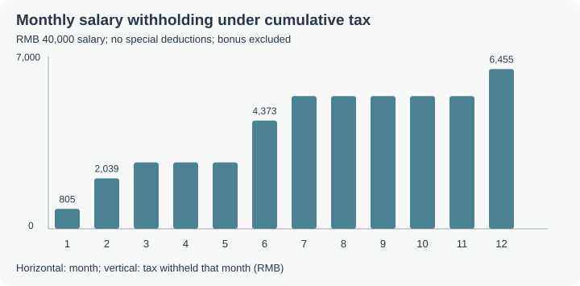
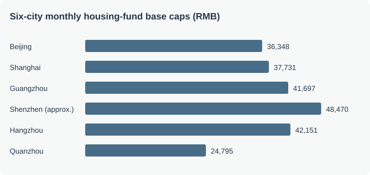
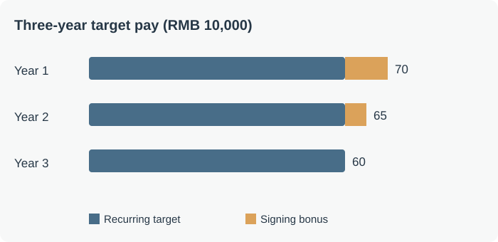
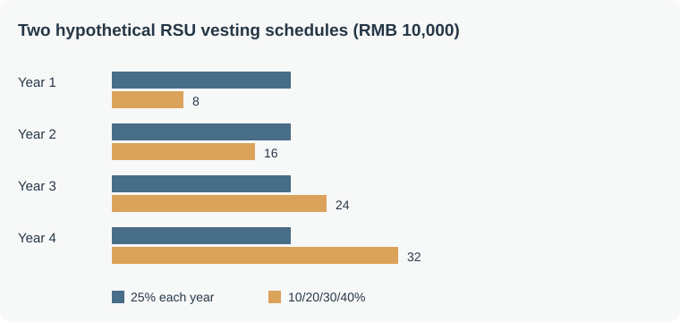
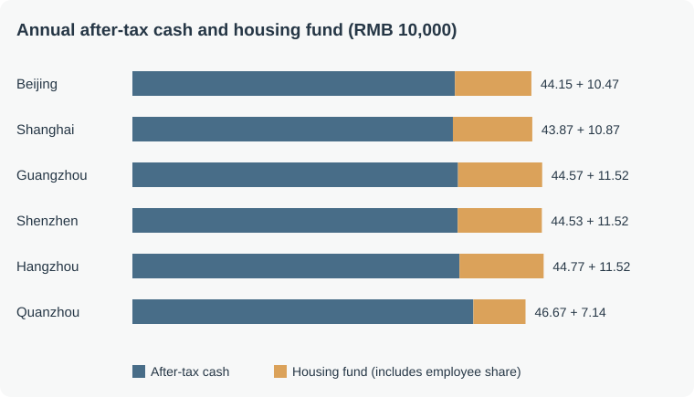

One offer advertises RMB 700,000 in annual compensation; another offers RMB 430,000 plus extra insurance and a pension plan. The headline figures are easy to compare, but the money works differently: some arrives monthly, some depends on performance, some is held in benefit accounts, and some is an equity valuation that may never become cash.

This guide builds a practical ledger for offers in Beijing, Shanghai, Guangzhou, Shenzhen, Hangzhou and Quanzhou, including technology companies, state-owned enterprises and research institutions. **All offers and calculations are hypothetical; policy references were checked on 9 November 2026.** Local rules and individual circumstances matter.

## Five layers of an offer

| Layer | Examples | What to check |
| --- | --- | --- |
| Fixed cash | Monthly salary and explicitly guaranteed pay | Contract, payment dates, probation terms |
| Variable cash | Annual, quarterly and project bonuses | Targets, performance rules and past payouts |
| Benefits | Employer housing-fund contributions, annuity and medical cover | Employer cost, vesting and access |
| One-off payments | Signing, relocation and retention bonuses | Payment dates, tax and clawback |
| Equity | Shares, restricted stock units and options | Vesting, price, exercise and liquidity |

These have different certainty, liquidity and risk. Employer social-insurance contributions provide protection and are part of employment cost; they are not simply wages in hand. Employee contributions already come from gross salary and should not be counted again as an extra employer benefit.

## 1. Fixed cash: base pay and after-tax salary

### Monthly salary, fixed pay and total compensation

Base usually means fixed gross pay, although the contract's “basic salary” can be only one component. Check whether allowances, position pay and monthly performance pay are guaranteed.

Total compensation (TC) commonly includes base, target bonus and equity, but the employer defines its quoted scope. RMB 420,000 fixed pay + RMB 140,000 target bonus + RMB 120,000 of equity scheduled to vest gives a target TC of RMB 680,000; only RMB 420,000 is fixed cash. Keep target, realized compensation and total employer cost distinct.

A raise changes future base pay: a 10% increase from RMB 40,000 to RMB 44,000 per month adds RMB 48,000 to annual fixed pay while it remains in force. A RMB 48,000 bonus is a one-time payment.

### Income tax: marginal is not average

Chinese resident individuals' comprehensive income is taxed progressively. Annual taxable income generally deducts the RMB 60,000 basic allowance, eligible social-insurance and housing-fund contributions, special additional deductions and other allowable items.

| Annual taxable income (RMB) | Rate | Quick deduction (RMB) |
| --- | ---: | ---: |
| Up to 36,000 | 3% | 0 |
| 36,000–144,000 | 10% | 2,520 |
| 144,000–300,000 | 20% | 16,920 |
| 300,000–420,000 | 25% | 31,920 |
| 420,000–660,000 | 30% | 52,920 |
| 660,000–960,000 | 35% | 85,920 |
| Above 960,000 | 45% | 181,920 |

#### Salary tax and special additional deductions

Annual taxable comprehensive income generally equals annual comprehensive income less the RMB 60,000 basic allowance, eligible social-insurance and housing-fund contributions, special additional deductions and other lawful deductions. Tax then follows the applicable rate and quick deduction. The RMB 60,000 is an allowance in the calculation, not cash paid to the employee. Comprehensive income may include labor remuneration, authors' remuneration and royalties, with income amounts determined under the applicable rules.

The seven common special additional deductions, subject to eligibility, are **care of children under three, children's education, continuing education, major medical expenses, housing-loan interest, housing rent and support for elderly dependants**. Each has its own eligibility, limits and filing requirements.

For eligible rent, Beijing, Shanghai, Guangzhou, Shenzhen and Hangzhou generally use RMB 1,500 per month; other cities follow the applicable city category. An RMB 18,000 annual deduction entirely within a 25% marginal bracket reduces tax by RMB 4,500, not RMB 18,000. If the deduction crosses brackets, calculate savings in stages. Restrictions also apply to an individual and spouse claiming rent and mortgage interest; see the [tax authority's rent guidance](https://shanghai.chinatax.gov.cn/tax/zcfw/rdwd/202603/t479656.html).

##### The seven deductions: amounts and eligibility

The table reflects publicly available rules checked on **9 November 2026**. Amounts reduce taxable income when the conditions are met; they are **not cash reimbursements or direct tax refunds**.

| Deduction | Main amount | Eligibility and allocation |
| --- | --- | --- |
| Care of a child under three | RMB 2,000 per child per month | From birth month through the month before age three; one parent may claim 100% or each 50%, with the method fixed for the tax year |
| Children's education | RMB 2,000 per child per month | Qualifying preschool and full-time education; one parent may claim 100% or each 50%, with the method fixed for the tax year |
| Continuing education | Eligible domestic degree education: RMB 400/month, up to 48 months per degree; eligible professional qualification: RMB 3,600 in the year the certificate is obtained | Rules depend on the type, certificate and duration. For eligible undergraduate-or-lower continuing education, the individual or a parent may claim under the rules, without double counting |
| Major medical expenses | Eligible out-of-pocket expenses after basic medical reimbursement above RMB 15,000, up to RMB 80,000 per patient per year | Limited to qualifying in-catalog expenses; the taxpayer or spouse can claim an adult's expense, one parent can claim a minor child's expense, and each patient's amount is calculated separately at annual settlement |
| Housing-loan interest | RMB 1,000/month for eligible first-home loan interest, at most 240 months | Qualifying interest must actually arise; spouses normally choose one claimant, with special rules for qualifying loans each obtained before marriage |
| Housing rent | RMB 1,500, 1,100 or 800/month according to the main work city's category | The taxpayer must have no owned home in the main work city and meet other conditions; spouses in the same main work city can claim only once, and rent and mortgage deductions have allocation restrictions |
| Support for elderly dependants | Only child: RMB 3,000/month; others share RMB 3,000/month with siblings, capped at RMB 1,500 per person | An eligible dependant includes a parent aged 60 or over; agreed or designated sharing requires written documentation and the method and amount are fixed for the tax year |

Sources: [childcare and education](https://www.chinatax.gov.cn/chinatax/n810341/n810760/c5211365/content.html), [continuing education and medical expenses](https://jiangsu.chinatax.gov.cn/art/2023/11/10/art_9280_439902.html), [medical deduction claimants](https://tianjin.chinatax.gov.cn/11200000000/0300/030005/20260720094746189.shtml), [mortgage interest](https://shanghai.chinatax.gov.cn/tax/zcfw/rdwd/202602/t479564.html), [rent](https://shanghai.chinatax.gov.cn/tax/zcfw/rdwd/202603/t479656.html) and [elder care](https://shanghai.chinatax.gov.cn/tax/zcfw/rdwd/202602/t479540.html). A parent's pension income does not by itself disqualify a qualifying elder-care deduction; a parent's medical expenses cannot simply be claimed as the child's major-medical deduction.

For example, if one patient's eligible in-catalog annual out-of-pocket amount after reimbursement is RMB 30,000, the amount above RMB 15,000 is RMB 15,000. If it is RMB 110,000, the excess is RMB 95,000 but the deductible amount is capped at RMB 80,000 for that patient. Eligibility depends on records and tax rules.

##### Calculate savings on the same salary: deductions can cross brackets

Assume a Beijing employee earns RMB 480,000 annual fixed wages, RMB 98,175.60 employee insurance and housing-fund contributions, and a RMB 60,000 basic allowance. The RMB 120,000 bonus is assumed to qualify for separate bonus taxation. Looking at salary alone, with no other income or deductions:

| Scenario | Special additional deduction | Taxable salary | Salary tax | Saving versus no deduction |
| --- | ---: | ---: | ---: | ---: |
| None | RMB 0 | RMB 321,824.40 | RMB 48,536.10 | — |
| Qualifying rent | RMB 18,000/year | RMB 303,824.40 | RMB 44,036.10 | RMB 4,500.00 |
| Rent plus one child's education, both lawfully claimed in full by this taxpayer | RMB 42,000/year | RMB 279,824.40 | RMB 39,044.88 | RMB 9,491.22 |

The final saving is not 42,000 × 25% = RMB 10,500: the deduction crosses the RMB 300,000 threshold. RMB 21,824.40 saves tax at 25% and the remaining RMB 20,175.60 at 20%. This describes the calculation across brackets, not separate policy rates for rent and education. Eligibility and family allocation must be checked individually.

##### Why does monthly withholding change when salary stays the same?

Salary generally uses **cumulative withholding**: the current month's withholding equals cumulative tax due through that month less previous withholding. Assume RMB 40,000 salary, RMB 8,181.30 employee social-insurance and housing-fund contributions and RMB 5,000 basic allowance every month, with no special additional deductions or other changes. Cumulative taxable income grows by RMB 26,818.70 each month.

| Month | Cumulative taxable income | Cumulative withholding due | Current month's withholding |
| --- | ---: | ---: | ---: |
| 1 | RMB 26,818.70 | RMB 804.56 | RMB 804.56 |
| 2 | RMB 53,637.40 | RMB 2,843.74 | RMB 2,039.18 |
| 6 | RMB 160,912.20 | RMB 15,262.44 | RMB 4,373.09 |
| 12 | RMB 321,824.40 | RMB 48,536.10 | RMB 6,454.96 |

Each current-month amount subtracts the **immediately preceding month's** cumulative withholding, even if that month is not shown. Changes in salary, contributions or deductions change actual withholding. Annual settlement considers all comprehensive income and prior withholding. A qualifying bonus separately taxed under the rules is excluded from the salary table.

##### Filing and annual settlement

- Enter the deduction year and required details in the individual income-tax app or natural-person e-tax system. Eligible deductions can generally be claimed through payroll withholding or in annual settlement; **major medical expenses are claimed in annual settlement**.
- Coordinate allocations with a spouse or siblings, update changes in leases, education and family circumstances, and keep required contracts, receipts or sharing agreements.
- When comprehensive-income settlement is required, the normal filing window is **1 March through 30 June of the following year**. Not everyone must file; the [settlement rules](https://shanxi.chinatax.gov.cn/web/detail/sx-11400-545-1805161) describe required and exempt cases.
- Eligible deductions omitted earlier may be added under the rules at settlement. A refund is calculated from annual tax due versus tax already withheld; it is not the deduction amount itself. Applicable underpayment must also be handled according to the rules. See [deductions that may be added](https://tianjin.chinatax.gov.cn/11200000000/0300/030005/20260506101227073.shtml).

Other lawful deductions are distinct from the seven special additional deductions. For example, contributions to a personal pension funding account can be deducted as paid up to RMB 12,000 per year, subject to the rules. Access is restricted and investment returns and withdrawals have separate tax treatment; the deduction amount is not itself the tax saving. [Tax authority guidance](https://guangxi.chinatax.gov.cn/nsfw/nszx/rdwd/202607/t20260701_435189.html).

Reaching the 30% bracket does not tax all income at 30%. Monthly payroll generally uses cumulative withholding; withholding may rise later in the year, followed by an annual settlement where applicable.

## 2. Variable cash: performance and bonuses

### How much of an extra salary multiple is paid?

“35k × 16” implies RMB 560,000: RMB 420,000 over 12 months plus a target four-month bonus of RMB 140,000. Suppose that bonus is multiplied by performance factor \(K\):

| Factor | Gross annual cash | Equivalent months |
| ---: | ---: | ---: |
| 0 | RMB 420,000 | 12 |
| 0.5 | RMB 490,000 | 14 |
| 1 | RMB 560,000 | 16 |
| 1.5 | RMB 630,000 | 18 |

Adjust the hypothetical performance factor to see gross annual cash and equivalent salary months. Actual bonus rules depend on the employer.



Actual rules vary. Ask how many months are guaranteed, what the target is and what was historically paid. Performance grades have no universal meaning and may affect bonuses, raises, promotion and equity refreshes. A performance improvement plan (PIP) does not automatically mean immediate dismissal.

### How is the annual bonus taxed?

The [annual one-off bonus policy](https://fgk.chinatax.gov.cn/zcfgk/c102416/c5211524/content.html) runs through 31 December 2027: qualifying bonuses may be taxed separately or included in comprehensive income. The [separate method is available once per tax year](https://shanghai.chinatax.gov.cn/tax/zcfw/rdwd/202501/t474844.html). The better choice depends on individual circumstances. A signing or quarterly bonus does not automatically qualify merely because it is paid once.

For separate taxation, divide the qualifying bonus by 12 to find the monthly rate and quick deduction, then calculate **total bonus × rate − quick deduction**. For a RMB 120,000 bonus, 120,000 / 12 = RMB 10,000, corresponding to 10% and RMB 210, so tax is RMB 11,790 and the net bonus is RMB 108,210.

At some thresholds, a slightly larger bonus can result in lower net pay because the rate applied to the whole bonus changes. Compare separate and combined taxation against full-year income and deductions; do not assume all one-off payments qualify.

Payment timing matters too. The same annual amount paid monthly provides a different cash flow from a large performance-dependent year-end payment. Avoid budgeting regular expenses against a bonus that has not yet been earned.

## 3. Benefits and protection: social insurance and long-term benefits

### Social insurance and the housing fund

The five social-insurance categories are pension, medical, unemployment, work injury and maternity insurance. The housing provident fund is separate. Employees and employers generally contribute to pension, medical and unemployment insurance; employers normally fund work-injury and maternity insurance. Rates, medical tiers and contribution bases vary by location.

#### What the five insurances cover

| Scheme | Employee | Employer | Purpose |
| --- | --- | --- | --- |
| Pension | Commonly 8% of assessed base | Local statutory rate | Personal and pooled components support retirement benefits |
| Medical | Generally contributes; local tiers vary | Local rate | Personal-account and pooled benefits have different rules and reimbursement limits |
| Unemployment | Generally contributes; rates vary | Local rate | Protection when eligibility conditions are met |
| Work injury | Normally no contribution | Contributes at the applicable rate | Eligible work-related injury and medical benefits; rates can vary by industry |
| Maternity | Normally no contribution | Contributes under local rules | Eligible maternity medical expenses and allowances; often administered with medical insurance |

These are common employee arrangements; consult the local rules. Statutory coverage applies during probation too. Lower contributions can increase current cash without necessarily improving protection.

##### Pension: income after retirement

At an assessed RMB 20,000 base, the employee's 8% contribution is RMB 1,600 and the employer's 16% is RMB 3,200. The employee contribution enters the personal account; the employer contribution generally enters a pooled fund. Benefits depend on contribution history, assessed wages, location and personal account. The personal-account component generally divides the account balance by the applicable calculation months; the basic component is calculated separately.

Under the [gradual retirement reform](https://www.gov.cn/yaowen/liebiao/202409/content_6974294.htm), the minimum contribution period for monthly basic pension rises by six months each year from 2030, reaching 20 years in 2039. Other requirements, including retirement age, also apply.

##### Medical: outpatient, hospital and medicines

Personal-account funds can be used for eligible care and prescriptions and, subject to rules, family sharing. The pooled fund pays eligible costs. As an illustration, if RMB 8,000 of a RMB 10,000 bill is covered, a hypothetical RMB 1,000 deductible and 80% reimbursement produce RMB 5,600 from the pooled fund; the remaining RMB 4,400 is borne by the individual or other channels. These are explanatory assumptions, not a city's benefit schedule.

##### Unemployment: a buffer when income stops

Eligible workers can receive unemployment insurance benefits and related medical coverage. Conditions generally include at least one year of contributions, involuntary termination, registration and a willingness to seek work; the agency determines eligibility. Resigning voluntarily usually does not satisfy the involuntary-termination condition, though specific circumstances matter.

The benefit is not a fixed percentage of former pay. For benefits from September 2026, [Shenzhen](https://www.sz.gov.cn/ztfw/shbz/wyk_183996/content/mpost_12981985.html) pays RMB 2,430 per month, 90% of its RMB 2,700 minimum wage; duration depends on applicable rules.

##### Work injury and maternity: employer-funded benefits

Work-injury insurance can cover eligible medical treatment, rehabilitation, disability and death benefits. Wages and benefits during an approved work-injury leave period are handled under applicable rules. Maternity insurance covers eligible medical expenses and maternity allowances. Male employees are also covered under the scheme; personal and spouse benefits depend on local rules. These contributions are normally paid by employers, not employees.

The general formula is **monthly contribution = assessed base × contribution rate**. The base often reflects prior-year wage income and is subject to local floors and ceilings; rules for new employees may differ. Social insurance and housing funds can have different bases, caps and adjustment dates.

Employee pension contributions create personal-account entitlements; employer contributions generally go to a pooled fund. Medical insurance also has personal and pooled components. These are protections and future entitlements, not an ordinary cash deposit.

Both employee and employer housing-fund contributions enter the employee's account, subject to withdrawal and loan rules. At a hypothetical RMB 30,000 monthly base and equal rates:

| Employee + employer rate | Employee / month | Employer / month | Annual account increase |
| --- | ---: | ---: | ---: |
| 5% + 5% | RMB 1,500 | RMB 1,500 | RMB 36,000 |
| 7% + 7% | RMB 2,100 | RMB 2,100 | RMB 50,400 |
| 10% + 10% | RMB 3,000 | RMB 3,000 | RMB 72,000 |
| 12% + 12% | RMB 3,600 | RMB 3,600 | RMB 86,400 |

Adjust the equal employee and employer contribution rate to see each contribution and the account increase. This illustration assumes the same base for 12 months; local and employer rules can differ.



Moving from 5% to 12% increases annual deposits by RMB 50,400: half from the employer and half from the employee's own salary. Cash pay falls as the employee contribution rises; the actual after-tax difference also depends on tax. Compare both base and rate.

#### How to check whether an employer contributes correctly

1. Keep the contract, payslips and bonus records; determine prior-year assessable wages under local rules. New employees can have different assessment rules.
2. Check location, coverage, months, assessed bases and payment records through the [national social-insurance service](https://si.12333.gov.cn/) or local agencies. Check housing-fund bases, rates and employer deposits through the local fund center.
3. Compare the legally assessed wage against each scheme's local floor and ceiling. A minimum base is not automatically unlawful; it depends on the assessed wage and applicable rules.
4. Ask HR for the calculation if records differ. If unresolved, contact the social-insurance, medical-insurance or housing-fund agency, or 12333. Keep the supporting records.

The obligation to pay statutory social insurance cannot simply be waived by agreement; see the [Supreme People's Court interpretation](https://www.court.gov.cn/fabu/xiangqing/472691.html).

### What to check in six cities

| Location | Questions for HR |
| --- | --- |
| Beijing | Assessed bases, rates and policy periods for each scheme |
| Shanghai | Whether both ordinary and supplementary housing funds are offered, and each party's rates |
| Guangzhou | Whether pension, medical and housing funds use different caps |
| Shenzhen | Medical-insurance tier, each party's housing-fund rate and local withdrawal rules |
| Hangzhou | Separate contribution bases, rates and conditions of use |
| Quanzhou | District-specific housing-fund minimum base, employer rate and social-insurance base |

For example, [Beijing's 2026 housing-fund year](https://www.beijing.gov.cn/zhengce/zcjd/202608/t20260825_4835519.html) runs from July 2026 through June 2027, with a RMB 36,348 monthly base cap and ordinary contribution rates of 5%–12%. [Shanghai's social-insurance cap](https://rsj.sh.gov.cn/tdjjf_17554/20260824/t0035_1443297.html) is RMB 37,731 per month from July 2026; it must not automatically be used as the housing-fund cap. [Shenzhen's rules](https://zjj.sz.gov.cn/zcjzts/) set its housing-fund ceiling at three times the previous year's local average monthly wage for on-post employees; eligible employees may choose a personal rate above the employer rate.

[Quanzhou’s housing-fund policy](https://qzgjj.quanzhou.gov.cn/zwgk/zfxxgk/fdzdgknr/zcfggfxwj/202607/t20260706_3306842.htm) sets a monthly base cap of RMB 24,795 for July 2026 through June 2027. The minimum base is RMB 2,195 in the municipal area and districts such as Licheng and Fengze, and RMB 2,045 in Anxi, Yongchun and Dehua. The cap is not automatically every employee’s assessed base.

A generous package depends on the properly assessed base, the employer's contribution and supplementary benefits. Social insurance paid according to law is a basic obligation. Rent, living costs and career prospects also affect comparisons across cities.

#### Employee social-insurance rates in six cities, November 2026

Rates are **employer / employee**, applied to the relevant assessed base, which may differ by scheme. Work-injury insurance is employer-funded and varies by industry and experience rating.

| City | Pension | Medical including maternity | Unemployment | Work injury |
| --- | --- | --- | --- | --- |
| Beijing | 16% / 8% | 9.8% / 2% + RMB 3 | 0.5% / 0.5% | Employer rate varies; employee 0 |
| Shanghai | 16% / 8% | 9% / 2% | 0.5% / 0.5% | Employer rate varies; employee 0 |
| Guangzhou | 16% / 8% | 6.85% / 2% | 0.8% / 0.2% | Employer rate varies; employee 0 |
| Shenzhen | 16% / 8% | Tier 1: 6.5% / 2% | 0.8% / 0.2% | Employer rate varies; employee 0 |
| Hangzhou | 16% / 8% | 9.5% / 2% | 0.5% / 0.5% | Employer rate varies; employee 0 |
| Quanzhou | 16% / 8% | 7.5% / 2% | 0.5% / 0.5% | Employer rate varies; employee 0 |

References: [Beijing social insurance](https://www.bjfsh.gov.cn/zsk/zcwd/202608/t20260818_40116625.shtml) and [medical](https://www.bjsjs.gov.cn/gongkai/zwgkpd/ztzl/2024/mtyfz/ybzcxwd/202410/t20241021_86349.shtml), [Shanghai medical](https://shanghai.chinatax.gov.cn/zcfw/zcfgk/sbf/202603/t479836.html), [Guangzhou medical](https://wx12345.gzonline.gov.cn/km/showMsg?id=BEAFDBCFD), [Shenzhen medical](https://hsa.sz.gov.cn/gkmlpt/content/12/12567/post_12567884.html), [Hangzhou medical](https://www.hzzx.gov.cn/cshz/content/2025-10/16/content_9103412.htm), [Quanzhou medical](https://qzybj.quanzhou.gov.cn/zwgk/zfxxgk/fdzdgknr/sgfxwj/202301/t20230105_2834185.htm), and [Fujian unemployment](https://www.fzja.gov.cn/xjwz/zwgk/zfxxgkzdgz/jycy/zccs/202509/t20250903_5070513.htm). Confirm current local rates and eligibility in actual enrollment.

Shenzhen tier-one employer medical comprises 6% basic plus 0.5% maternity. Tier-two basic medical is 1.5% employer and 0.5% employee, with maternity separately employer-funded. Shenzhen household-registration holders can be subject to [additional employer local pension contributions](https://hrss.sz.gov.cn/szsi/sbjxxgk/zcfggfxwj/zcfg/ylbx/content/post_8207598.html). Shanghai's 9% includes 8.5% basic including maternity and 0.5% local supplementary medical. Guangzhou's 6.85% includes 6% basic and 0.85% maternity; Hangzhou's 9.5% includes 0.6% maternity.

#### Monthly employee and employer insurance: a conditional illustration

Using the six-city example's **RMB 40,000 assessed monthly wage**, subject to each scheme's cap, the table estimates social insurance only, excluding housing funds. For illustration, employer work-injury insurance is assumed at 0.2% of the pension base; actual work-injury bases and rates depend on local and industry rules. Shenzhen assumes a non-local household registration and tier-one medical insurance. Employer bases may also be assessed using the sum of employee bases or other applicable rules, so these are not payroll quotations.

| City | Employee insurance | Employer pension | Employer medical including maternity | Employer unemployment | Assumed employer work injury | Employer total |
| --- | ---: | ---: | ---: | ---: | ---: | ---: |
| Beijing | 3,819.54 | 5,815.68 | 3,562.10 | 181.74 | 72.70 | 9,632.22 |
| Shanghai | 3,961.76 | 6,036.96 | 3,395.79 | 188.66 | 75.46 | 9,696.87 |
| Guangzhou | 2,911.64 | 4,416.48 | 2,135.15 | 320.00 | 55.21 | 6,926.84 |
| Shenzhen | 2,960.90 | 4,416.48 | 2,186.15 | 320.00 | 55.21 | 6,977.84 |
| Hangzhou | 2,689.16 | 4,097.76 | 2,433.05 | 128.06 | 51.22 | 6,710.09 |
| Quanzhou | 2,403.77 | 3,662.88 | 1,716.98 | 114.47 | 45.79 | 5,540.12 |

For Beijing the illustrative employer amounts are RMB 5,815.68 pension, RMB 3,562.10 medical including maternity, RMB 181.74 unemployment and RMB 72.70 work injury, totaling approximately RMB 9,632.22 per month. Figures are rounded separately. Employer contributions do not all become an employee's personal-account balance.

#### Monthly contribution-base ranges

RMB per month, current as of November 2026; start dates vary by scheme. Quanzhou's unemployment range applies from October 2026. Work-injury bases and rates are assessed separately.

| City | Pension | Medical and maternity | Unemployment |
| --- | --- | --- | --- |
| Beijing | 7,270–36,348 | 7,270–36,348 | 7,270–36,348 |
| Shanghai | 7,546–37,731 | 7,546–37,731 | 7,546–37,731 |
| Guangzhou | 5,521–27,603 | 6,234–31,170 | 2,680–42,933 (reference) |
| Shenzhen | 5,521–27,603 | 6,727–33,633 | 2,700–48,471 (reference) |
| Hangzhou | 5,122–25,611 (reference) | 5,122–25,611 (reference) | 5,122–25,611 (reference) |
| Quanzhou | 4,579–22,893 | 4,579–22,893 | 4,579–22,893 |

Official sources appear in the detailed comparison below. Ranges marked reference use [Guangzhou](https://gz.bendibao.com/life/202519/355895.shtml), [Shenzhen](https://m.bendibao.com/bsy616048.html) and [Hangzhou](https://hz.bendibao.com/live/2026109/173298.shtm) policy summaries; verify them with the local agency.

For an assessed RMB 40,000 wage in Shenzhen, pension is capped at RMB 27,603, tier-one medical at RMB 33,633, and unemployment uses RMB 40,000. Different bases do not by themselves establish underpayment.

#### Housing-fund caps across six cities

The following are monthly base ceilings for the **July 2026–June 2027 housing-fund year**, in RMB. Employer annual amounts are scenarios calculated as ceiling × assumed employer rate × 12 before monthly rounding. A ceiling is neither an average contribution nor a promise of maximum payment.

| City | Monthly base cap | Illustrative annual employer contribution | Assumption |
| --- | ---: | ---: | --- |
| [Beijing](https://www.beijing.gov.cn/zhengce/zcjd/202608/t20260825_4835519.html) | 36,348 | approximately 52,341 | 12% employer rate |
| [Shanghai](https://www.shanghai.gov.cn/gwk/affairs/content/0064%40f3d788ec72e9404ebcbf3d27fda98435) | 37,731 | 31,694 at 7%; 54,333 at 7% plus 5% | Supplementary scheme is voluntary for employers |
| [Guangzhou](https://hrlib.ciic-cloud.cn/news/info?id=01m0yscpk4e65y2n50nwchhd34) | 41,697 | approximately 60,044 | 12%; linked notice is a reproduction |
| [Shenzhen](https://www.sz.gov.cn/hdjl/ywzsk/jsj/zfgjj/content/post_12893587.html) | approximately 48,470 | approximately 69,797 | Derived from published 2025 annual wage of RMB 193,881 ÷ 12 × 3; official rounding may differ |
| [Hangzhou](https://hznews.hangzhou.com.cn/jingji/content/2026-07/25/content_9263759.htm) | 42,151 | approximately 60,697 | 12%; linked notice is a reproduction |
| [Quanzhou](https://qzgjj.quanzhou.gov.cn/zwgk/zfxxgk/fdzdgknr/zcfggfxwj/202607/t20260706_3306842.htm) | 24,795 | approximately 35,705 | 12% employer rate |

The Shenzhen estimate uses [official wage statistics](https://www.sz.gov.cn/cn/xxgk/zfxxgj/tjsj/tjgb/content/mpost_12907800.html). It differs slightly through rounding from the earlier conversation's estimate; confirm the center's assessed value.

In Shanghai, “7% + 5%” refers to each party's ordinary plus supplementary contribution. If both contribute at those rates, each contributes 12%, or 24% combined. The [enterprise pension base cap in Guangdong](https://guangdong.chinatax.gov.cn/gdsw/mmsw_gkwj/2026-10/13/content_87b090a21cbb45a3b8adb477f596793a.shtml) is RMB 27,603 per month from July 2026, different from the housing-fund cap and not a substitute for the medical-insurance cap.

To judge generosity, verify the legally assessed base and then compare employer housing-fund, supplementary fund, annuity and medical benefits. If the stated base seems unexpectedly low, ask how it was assessed and consult the local agency if necessary.

#### How to withdraw housing funds in six cities

Contribution amounts are not automatically spendable cash. The comparison below uses common employee cases and policies available through **9 November 2026**. Eligibility, balance, contribution history, family scope and previous withdrawals affect the actual amount. Amounts per **person** and per **household** are not interchangeable; the relevant fund center makes the final assessment.

| City | Common rental withdrawal | Frequency and key conditions |
| --- | --- | --- |
| [Beijing](https://gjj.beijing.gov.cn/web/zwgk61/2024zcwj/436433464/436433466/436439104/index.html) | For commercial rentals without a rent invoice, RMB 2,000 per person per month under the specified procedure. With an invoice and registered lease, actual rent may be claimed, generally subject to the monthly contribution cap. | The applicant must have contributed in full for at least three consecutive months and the applicant and spouse must have no owned home in Beijing and rent. Monthly arrangements are available; eligible multi-child households and public or affordable rental housing have special actual-rent rules. |
| [Shanghai](https://service.shanghai.gov.cn/XingZhengWenDangKuJyhTest/XZGFDetails.aspx?docid=241015151102JbADRZpu6KkOIFz6TBv) | Market rental housing: generally up to RMB 4,000 per household per month, including single-person households; affordable rental housing follows actual rent. | Market-rent withdrawals generally cannot exceed actual rent. New applications since November 2024 can be monthly. Eligible new residents or people aged 35 or younger with an online-registered lease can claim actual rent; high-level talent has separate rules. |
| [Guangzhou](https://www.gz.gov.cn/attachment/7/7899/7899488/10482888.pdf) | For qualifying no-home rentals without a lease or with an unregistered lease, the fixed amount is RMB 2,000 per person per month. Registered leases follow a different assessment. | At least three months of full contributions and other conditions apply. A [reproduced service guide](https://m.gz.bendibao.com/life/371625_2.html?src=amap) describes withdrawal once every three months and a multi-child increase. A proposed increase to RMB 2,500 appeared in a [consultation draft](https://house.cnr.cn/kcb/20260923/t20260923_527822728.shtml); no final implementation notice was found in this check. |
| [Shenzhen](https://zjj.sz.gov.cn/xxgk/ztzl/rrkt/index.html) | For eligible no-home rentals, the temporary policy for 1 November 2025–31 October 2027 calculates eligible months at 80% of the monthly contribution due. | Ordinary rental rules require the employee and relevant household members to have no local home. Applications may be made monthly. Multi-child families and public or affordable rental housing have separate rules; calculate months in different policy periods separately. |
| [Hangzhou](https://zfgb.hangzhou.gov.cn/upload/default/bigfile/2025/06/11/20250611_9ab274879df247f9bcdc8a367966e83c.pdf) | Standard no-home rental cap: RMB 2,000/month in the urban districts and RMB 1,200/month in Tonglu, Chun'an and Jiande. | Eligible new residents or people aged 35 or younger with no local home and market rentals may withdraw the full monthly contribution under the rules. Registered affordable rental housing can be claimed against actual rent. Eligible withdrawals may be annual or arranged monthly, for at most 12 months. |
| [Quanzhou](https://qzgjj.quanzhou.gov.cn/zwgk/fgwj/zcjd/202605/t20260529_3295800.htm) | A household with no owned home in the contribution location renting commercial housing has a RMB 1,500/person/month allowance; qualifying families raising two or more children have RMB 1,700/month. | The 2026 adjustment applies from issue. Some older service pages still show RMB 12,000/year; use the newer policy and center assessment. Ask the center about [monthly rent transfers](https://qzgjj.quanzhou.gov.cn/bsfw/bszn/gjjtqzn/202408/t20240829_3076347.htm). |

In Shenzhen, the “monthly contribution due” includes **both employer and employee**. If each contributes RMB 4,800, the total is RMB 9,600; 80% gives an illustrative **RMB 7,680/month** for eligible months in the temporary policy period. Actual availability depends on the eligible months, account balance and assessment. [Shenzhen's explanation](https://zjj.sz.gov.cn/szszfhjsjwzgkml/szszfhjsjwzgkml/ywzsk/zfgjj/content/post_12703799.html).

##### Home purchase, repayment and other withdrawals

- **Beijing:** A qualifying purchase using a Beijing center housing-fund loan, including a combined loan, can be handled under the [purchase-withdrawal guide](https://gjj.beijing.gov.cn/web/zwfw5/386727/386730/386732/11098723/index.html). Eligible local owner-occupied renovation may also be claimed against qualifying invoices subject to limits; see the [2026 policy](https://gjj.beijing.gov.cn/web/zwgk61/2024zcwj/436433464/436433467/744089355/index.html).
- **Shanghai:** Eligible buyers of completed new commercial homes can apply to use their own and their spouse's housing funds for a down payment, subject to registration and other restrictions in the [2026 notice](https://www.shanghai.gov.cn/gwk/affairs/content/0064%40d3264980afe6482085504c6a56fb41ce). Qualifying housing-fund loans in other Yangtze River Delta provinces have a separate [repayment arrangement](https://www.shanghai.gov.cn/nw17239/20260721/558c1a9742ab41918268fae8073a212d.html).
- **Guangzhou:** Purchase and loan-repayment withdrawal conditions differ by property location, purchase and loan status. Eligible local buyers can apply for a down-payment withdrawal; see the [center's service materials](https://gjj.gz.gov.cn/attachment/7/7643/7643577/9792017.pdf) and [city service overview](https://rsj.gz.gov.cn/zzzq/shbz/gzsshbzk/yyzy/content/post_8730072.html). The proposal to allow purchases throughout China remains a consultation draft in the material checked.
- **Shenzhen:** For eligible down-payment withdrawals, a first-home claim cannot exceed account balance or down payment; a second-home claim cannot exceed 60% of account balance or the down payment. See the [housing authority's explanation](https://zjj.sz.gov.cn/szszfhjsjwzgkml/szszfhjsjwzgkml/ywzsk/zfgjj/content/post_12752620.html). Eligible employees can sign a [repayment withdrawal agreement](https://zjj.sz.gov.cn/hdjl/ywzs/content/post_12893678.html) for monthly payments.
- **Hangzhou:** Eligible purchase and repayment withdrawals follow applicable rules. For a local owner-occupied purchase, the employee and spouse may claim qualifying deed tax up to the actual tax paid, under the [2026 notice](https://zfgb.hangzhou.gov.cn/11/103220263/t130220263034/530322.shtml).
- **Quanzhou:** For qualifying purchases of owner-occupied housing in Fujian, the buyer's and spouse's parents and children may apply for intergenerational support withdrawal under the rules. Resale housing, mortgages and supervised accounts have distinct conditions; see the [center's explanation](https://qzgjj.quanzhou.gov.cn/zwgk/fgwj/zcjd/202605/t20260529_3295800.htm).

Leaving a job, retirement, settling abroad and other locally defined cases may involve account suspension, transfer or closing withdrawal. **Leaving a job does not automatically permit immediate withdrawal of the entire balance.** Check the specific fund center, including any provincial or central branch, account status, housing location and family eligibility; use the center's official services or 12329 for documents and limits. Withdrawal can affect a housing-fund loan calculated from account balance, as in [Shenzhen's loan rules](https://zjj.sz.gov.cn/hdjl/ywzs/gjj/content/post_12798776.html).

Housing-fund **withdrawal** and the tax **rent deduction** in section 1 are different systems. A withdrawal moves eligible money from the worker's fund account; a tax deduction reduces taxable income. A RMB 2,000 housing-fund withdrawal is not a RMB 2,000 tax credit.

### Supplementary insurance and annuities

“Six insurances and two funds” is not a single standardized statutory package. The extra insurance may be supplementary medical cover; the second fund may be an enterprise or occupational annuity. Check deductibles, reimbursement rates, hospital networks, family coverage and annual limits.

An enterprise annuity supplements basic pension insurance. Under the [enterprise annuity rules](https://www.mohrss.gov.cn/xxgk2020/gzk/gz/202112/P020211230641789213268.pdf), annual employer contributions cannot exceed 8% of the enterprise's employee wage bill, and combined employer and employee contributions cannot exceed 12%. This does not guarantee an 8% + 4% rate for each person. At a hypothetical RMB 20,000 monthly base, 8% employer and 4% employee contributions total RMB 19,200 and RMB 9,600 a year respectively. Employer contributions may vest over time; ask what happens on departure. Occupational annuities mainly cover relevant public-sector staff; working for a state-owned enterprise does not automatically confer public-institution status or an occupational annuity.

Occupational and enterprise annuities have different institutional rules. The [occupational annuity measures](https://gks.mof.gov.cn/guojijiejian/201806/P020180621597339944974.pdf) provide for eligible public-sector employers to contribute 8% of the wage bill and individuals 4% of their contributory wages, credited to their occupational annuity accounts under applicable rules. Employer bookkeeping and funding arrangements depend on the type of institution and applicable rules.

#### Annuity vesting and medical coverage

In the example above, RMB 28,800 enters the annuity account annually: RMB 19,200 from the employer and RMB 9,600 from the employee. This is a long-term pension arrangement rather than an on-demand deposit. Investment returns and vesting affect the eventual benefit. [Central-enterprise guidance](https://wap.sasac.gov.cn/n2588035/n2588320/n2588335/c20235138/content.html) allows gradual vesting of employer contributions, with full vesting no later than eight years; check the employer's plan.

Request the supplementary medical plan summary: outpatient coverage, deductible, reimbursement after basic insurance, hospitals and private departments, prescription drugs, family coverage, annual cap, waiting period and who pays the premium. A plan cannot be assigned a reliable cash value from its name alone.

## 4. One-off payments: signing and allowances

A signing bonus may be paid on joining, after probation or over several years, and may already be included in first-year TC. Check service requirements, payment dates, gross-versus-net clawback and the tax treatment if repayment is required. Ask separately about settling-in, relocation, rent, retention, make-whole, referral, project and research awards. Reimbursements and cash allowances do not necessarily receive the same tax treatment.

Suppose recurring target compensation is RMB 600,000 a year and signing bonuses are RMB 100,000 in year one and RMB 50,000 in year two:

The three-year target totals RMB 1.95 million, averaging RMB 650,000 a year, while the recurring target remains RMB 600,000. Compare first-year, three-year average and post-bonus pay. The illustration excludes raises, share-price changes and performance variation.

### Other payments: ask about each one

| Payment | Purpose | Questions |
| --- | --- | --- |
| Settling-in or relocation | Moving or joining a location | Cash or reimbursement, payment schedule and repayment |
| Rent allowance | Housing costs | Duration, overlap with talent subsidies and tax |
| Retention bonus | Staying until a specified date | Eligibility, assessment and early departure |
| Make-whole bonus | Replacing forfeited pay or equity | Basis, date and service requirements |
| Referral, project or research award | Meeting a specified target | Eligibility, caps and repeatability |

For a RMB 700,000 first-year offer that includes a RMB 100,000 signing bonus and RMB 600,000 recurring target pay, the bonus must not be added twice. Ask how a gross clawback interacts with tax already withheld. Cash allowances and expense reimbursements may have different tax treatment.

## 5. Equity: shares, RSUs and options

Shares represent ownership. Restricted stock units (RSUs) promise shares when conditions are met. Options give the right to buy shares at a set exercise price. An employee stock ownership plan (ESOP) is an arrangement whose rights depend on its documents.

Suppose an RSU grant valued at RMB 800,000 on grant is vested over four years. Equal vesting gives RMB 200,000 per year at grant-date value; a 10% / 20% / 30% / 40% schedule gives RMB 80,000 / 160,000 / 240,000 / 320,000. Actual value depends on the share price and conditions. Check treatment of unvested awards on departure and whether annual refresh grants exist.

Options require exercise costs. For 10,000 vested options with a RMB 5 strike and a realizable sale price of RMB 20, hypothetical profit before tax and fees is 10,000 × (20 − 5) = RMB 150,000; exercise requires RMB 50,000. At a private company, ask about financing, dilution, expiry, post-departure exercise windows, buybacks and exit routes. A valuation is not spendable cash without liquidity. Equity tax depends on the instrument, company and transaction timing.

### How option value changes with share price

The interactive example assumes 10,000 fully vested options, a RMB 5 strike and an immediate sale at the selected price. Exercise is assumed only above the strike. The result is theoretical and excludes taxes, transaction restrictions and time value; it does not establish an actual exit opportunity.



### Vesting schedules side by side

| Year | Equal 25% vesting | Back-loaded 10% / 20% / 30% / 40% |
| --- | ---: | ---: |
| 1 | RMB 200,000 | RMB 80,000 |
| 2 | RMB 200,000 | RMB 160,000 |
| 3 | RMB 200,000 | RMB 240,000 |
| 4 | RMB 200,000 | RMB 320,000 |

The table uses the RMB 800,000 grant-date valuation, before tax or price changes. Without refresh grants, equity income can fall after the initial grant ends. A cliff is the waiting period before an initial vest; it does not mean the employee owns accrued shares before vesting.

For options, ask about the percentage of fully diluted shares, future dilution, post-departure exercise window, cash needed and the possibility of no exit. Keep illiquid private-company equity separate in a cash budget.

Under the [listed-company equity incentive tax policy](https://fgk.chinatax.gov.cn/zcfgk/c102416/c5211082/content.html), qualifying income can be taxed separately using the comprehensive-income rate table through 31 December 2027; multiple qualifying awards in one tax year are combined. Certain [domestically listed company awards](https://guangdong.chinatax.gov.cn/gdsw/zjfg/2024-04/28/content_ec4f1ff298e04296acc11866d22fb710.shtml), following required filing, may be paid over at most 36 months; departure during that period triggers payment before leaving. This installment rule cannot automatically be applied to overseas listings.

## Putting the five layers together

### Salary calculator: base pay, annual and signing bonuses

Choose a city and enter your amounts to update one chart showing where base salary, the annual bonus and signing bonus go. Switch between monthly averages and annual amounts to see gross income, allocated tax and after-tax cash for each component. Enter monetary amounts in k (thousands of RMB): for example, 40 means RMB 40,000 per month and 120 means a RMB 120,000 annual bonus. Results are displayed in RMB. Defaults are Shanghai, a 12% housing-fund rate for each party, a RMB 100,000 signing bonus and a full-year housing-rent deduction. Keep the rent deduction selected only if you qualify; expand the panel to change it. Default assessed bases are derived from the contributory wage and illustrative local limits. Expand the base settings to enter scheme-specific values. The signing bonus is assumed to be taxed as wages; choose separate or combined taxation for the annual bonus where eligible.



### Six-city after-tax comparison: a fully specified RMB 600,000 offer

This comparison specifies bases, rates and deductions for Beijing, Shanghai, Guangzhou, Shenzhen, Hangzhou and Quanzhou. **It annualizes a fixed set of rules known in November 2026 over 12 months; it is not an actual January–December 2026 payslip.**

Common assumptions: a resident employee works all year, earning RMB 40,000 gross per month (RMB 480,000 annually) plus a fully paid RMB 120,000 bonus eligible for separate annual-bonus tax. Assume the prior-year assessed monthly wage for each contribution scheme is **RMB 40,000** in every city, subject to each scheme's cap. This is an explicit assumption, not a claim that bonuses are excluded from future contribution bases: if an earlier year's bonus enters assessed wages, the actual base may be higher.

To make the cities comparable, all cases use only the RMB 60,000 annual basic tax allowance, **without rent or other special additional deductions**. Employee and employer each contribute 12% to housing funds. In Shanghai this assumes both 7% ordinary and 5% supplementary contributions, and an employer that offers the supplementary plan. Shenzhen uses tier-one employee medical insurance. Work-injury and maternity insurance are employer-funded here. Annuities, extra insurance, other deductions and possible local additional charges are excluded. Beijing includes RMB 3 per month for major medical mutual aid.

#### Monthly employee contributions

All amounts are RMB. Each entry shows assessed base × employee rate, with monthly items rounded to cents. Shanghai's ordinary and supplementary housing funds are combined; separate official rounding may differ slightly.

| City | Pension | Medical | Unemployment | Employee housing fund | Monthly total |
| --- | ---: | ---: | ---: | ---: | ---: |
| Beijing | 36,348 × 8% = 2,907.84 | 36,348 × 2% + 3 = 729.96 | 36,348 × 0.500% = 181.74 | 36,348 × 12% = 4,361.76 | 8,181.30 |
| Shanghai | 37,731 × 8% = 3,018.48 | 37,731 × 2% = 754.62 | 37,731 × 0.500% = 188.66 | 37,731 × 12% = 4,527.72 | 8,489.48 |
| Guangzhou | 27,603 × 8% = 2,208.24 | 31,170 × 2% = 623.40 | 40,000 × 0.200% = 80.00 | 40,000 × 12% = 4,800.00 | 7,711.64 |
| Shenzhen | 27,603 × 8% = 2,208.24 | 33,633 × 2% = 672.66 | 40,000 × 0.200% = 80.00 | 40,000 × 12% = 4,800.00 | 7,760.90 |
| Hangzhou | 25,611 × 8% = 2,048.88 | 25,611 × 2% = 512.22 | 25,611 × 0.500% = 128.06 | 40,000 × 12% = 4,800.00 | 7,489.16 |
| Quanzhou | 22,893 × 8% = 1,831.44 | 22,893 × 2% = 457.86 | 22,893 × 0.500% = 114.47 | 24,795 × 12% = 2,975.40 | 5,379.17 |

Sources and limits: [Beijing bases](https://www.beijing.gov.cn/zhengce/zcjd/202608/t20260821_4831683.html), [Shanghai social insurance](https://rsj.sh.gov.cn/tdjjf_17554/20260824/t0035_1443297.html) and [housing funds](https://www.shanghai.gov.cn/gwk/affairs/content/0064%40f3d788ec72e9404ebcbf3d27fda98435), [Guangdong pension](https://guangdong.chinatax.gov.cn/gdsw/mmsw_gkwj/2026-10/13/content_87b090a21cbb45a3b8adb477f596793a.shtml), [Guangzhou medical](https://wx12345.gzonline.gov.cn/km/showMsg?id=BEAFDBCFD), [Shenzhen medical](https://hsa.sz.gov.cn/gkmlpt/content/12/12567/post_12567884.html), [Guangdong unemployment rules](https://rsj.gz.gov.cn/zcfg/flfg/content/post_10241930.html), [Hangzhou social-insurance bases](https://hz.bendibao.com/live/2026109/173298.shtm) (reproduced policy information), and Quanzhou's [pension and unemployment](https://rst.fujian.gov.cn/zw/ztzl/zxzt/sbhm/zxsl/zcfg/202610/t20261008_7221778.htm) and [medical bases](https://www.quanzhou.gov.cn/zfb/xxgk/zfxxgkzl/qzdt/qzyw/202606/t20260630_3304627.htm). Housing-fund sources appear in the six-city table in section 3. Employee unemployment rates are assumed at 0.2% in Guangdong and 0.5% in the other cities; confirm the actual assessment locally.

The Quanzhou unemployment cap of RMB 22,893 applies from October 2026; other bases also have different start dates. Multiplying this parameter set by 12 illustrates a full year at a fixed rate and **does not reconstruct actual 2026 calendar-year contributions**.

#### Annual tax and cash

Taxable salary = 480,000 − 60,000 − annual employee contributions. Salary tax follows the comprehensive-income table. The qualifying RMB 120,000 bonus is separately taxed at RMB 11,790. After-tax cash = 600,000 − employee contributions − salary tax − bonus tax.

| City | Employee annual contributions | Salary tax | Bonus tax | **Annual after-tax cash** | Housing-fund increase (employee + employer) |
| --- | ---: | ---: | ---: | ---: | ---: |
| Beijing | 98,175.60 | 48,536.10 | 11,790.00 | **441,498.30** | 104,682.24 |
| Shanghai | 101,873.76 | 47,611.56 | 11,790.00 | **438,724.68** | 108,665.28 |
| Guangzhou | 92,539.68 | 49,945.08 | 11,790.00 | **445,725.24** | 115,200.00 |
| Shenzhen | 93,130.80 | 49,797.30 | 11,790.00 | **445,281.90** | 115,200.00 |
| Hangzhou | 89,869.92 | 50,612.52 | 11,790.00 | **447,727.56** | 115,200.00 |
| Quanzhou | 64,550.04 | 56,942.49 | 11,790.00 | **466,717.47** | 71,409.60 |

For Quanzhou, monthly employee contributions are RMB 5,379.17, or RMB 64,550.04 annually. Taxable salary is 480,000 − 60,000 − 64,550.04 = RMB 355,449.96. At the 25% bracket, salary tax is RMB 56,942.49; with RMB 11,790 bonus tax, after-tax cash is RMB 466,717.47. The housing-fund account receives RMB 71,409.60 in total from employee and employer, subject to use restrictions.

This is not a ranking of actual city pay. Gross pay, assessed prior-year wages and generous housing-fund rates were held fixed by assumption. Lower cash deductions do not automatically mean better protection. Restricted fund balances and spendable cash have different liquidity.

This comparison excludes rent deductions. If the Beijing employee qualifies for RMB 18,000 of annual rent deductions, other assumptions unchanged, tax falls by RMB 4,500 and annual cash becomes approximately RMB 446,000. [Rent deductions](https://tianjin.chinatax.gov.cn/nsrxt/video/20251225/09.shtml) depend on eligibility and city category; do not automatically apply RMB 1,500 per month to Quanzhou.

The five-city table in the original conversation did not disclose enough medical and unemployment parameters to reproduce it. This recalculation uses the bases and assumptions above; Shenzhen, for example, has a RMB 33,633 medical cap and a 0.2% assumed employee unemployment rate.

### Employer types and contracting entities

| Employer | Points to check |
| --- | --- |
| Technology company | Fixed pay, performance payouts, equity and hours |
| AI startup | Cash security, financing, option exercise and exits |
| Central SOE or subsidiary | Contracting entity, grade, annuity, promotion and location |
| Market-oriented SOE subsidiary | Actual benefits compared with the parent company |
| SOE research institute | Project and research awards, fixed income and resources |
| Public research institution | Public-institution status, appointment terms, occupational annuity and assessment |

State ownership describes control or investment, not automatic public-institution employee status. Benefits can differ even among entities in the same group.

### Compare three hypothetical offers

Amounts below are in RMB 10,000:

| Item | A: Beijing tech | B: Shanghai SOE | C: Shenzhen AI startup |
| --- | ---: | ---: | ---: |
| Fixed salary | 48 | 30 | 42 |
| Target annual bonus | 12 | 10 | 8 |
| Annual target equity | 0 | 0 | 15 |
| First-year signing bonus | 10 | 3 | 5 |
| First-year target TC | 70 | 43 | 70 |
| Recurring target TC | 60 | 40 | 65 |

A and C have equal first-year target TC, but C includes RMB 150,000 of equity whose liquidity needs checking. B has a lower headline amount, with hypothetical supplementary housing fund, annuity and medical benefits to verify. Location, hours and career prospects matter too.

Time has a cost. If A and B pay RMB 450,000 and RMB 350,000 after tax, with 55 and 40 hours of actual work per week respectively, a crude 52-week calculation gives about RMB 157 and RMB 168 per hour. This is an opportunity-cost indicator, not statutory hourly pay; it ignores leave, commuting and living costs.

#### Build an offer valuation table

| Measure | How to compare |
| --- | --- |
| Guaranteed annual cash | Fixed annual wages plus explicitly guaranteed cash; distinguish gross and net |
| Target annual cash | Fixed wages plus target performance and bonuses, with conditions |
| Realizable three-year value | Estimate net cash, liquid equity and vested benefits by year without double counting employee contributions |
| Career and life value | Assess hours, growth, location, risk and personal priorities separately |

Model bonus and equity under conservative, base and optimistic cases. For RMB 420,000 fixed cash, RMB 100,000 target bonus and RMB 150,000 target annual equity, assume bonus realization of 50% / 100% / 130% and equity value of 50% / 100% / 150%. Illustrative gross totals are RMB 545,000 / 670,000 / 775,000. **These assumptions are not probabilities, net income or guaranteed liquidity.** Allocate a signing bonus only to the year paid; consider restrictions on housing funds and annuities.

#### Compensation terms at a glance

| Term | Follow-up |
| --- | --- |
| 40k × 15 | Guaranteed versus performance-dependent months |
| RMB 600,000 TC / RMB 700,000 first-year TC | Fixed cash, target bonus, equity and signing bonus |
| RMB 100,000 signing bonus | Timing, gross or net, service term and clawback |
| Four-month annual bonus | Guarantee or performance target |
| 12% housing fund / Shanghai 7%+5% | Base, each party's rate and whether supplementary fund exists |
| Six insurances and two funds / annuity 8%+4% | Scheme, assessed base and vesting |
| RMB 200,000 annual shares / RMB 1 million options | Number, vesting, valuation, strike, tax and liquidity |
| 10% raise / guaranteed payment | Effect on fixed base and written conditions |

### Before signing

The 19 items can be checked below. Progress exists only on this page and resets on refresh; the widget does not request salary figures or upload them.



#### Compensation

1. Do fixed monthly pay, contractual pay and the gross amount agree?
2. How many salary months are guaranteed and how many depend on performance?
3. What are the target bonus, payout rules and payment date?
4. Is the signing bonus included in TC, paid in installments or subject to clawback?
5. Are rent, meals, transport or talent allowances available, and on what terms?

#### Social insurance and housing fund

6. Where is social insurance paid and what is each scheme's assessed base?
7. What are the employee and employer housing-fund rates and assessed base?
8. Is a supplementary housing fund offered where applicable?
9. Are enterprise annuity and supplementary medical cover offered, and on what terms?

#### Equity and performance

10. Are the awards RSUs, options or another plan?
11. What are the grant quantity, valuation basis and vesting schedule?
12. What happens to vested and unvested awards on departure?
13. Are annual equity refresh grants offered?
14. What performance factors and assessments affect bonuses and equity?

#### Other terms

15. Are the contracting entity, signing location and actual workplace clear?
16. What are the probation duration, salary and assessment terms?
17. What are the non-compete, penalty, service and compensation terms?
18. What are the leave, overtime, time off, remote-work and actual hours arrangements?
19. Which commitments are written into the formal offer, contract or agreements?

Ask for significant monetary promises and payout conditions in formal documents; check oral expectations against the actual agreement and applicable rules.
