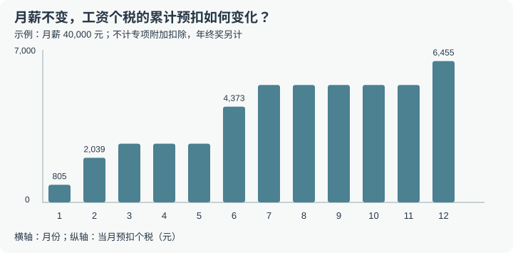
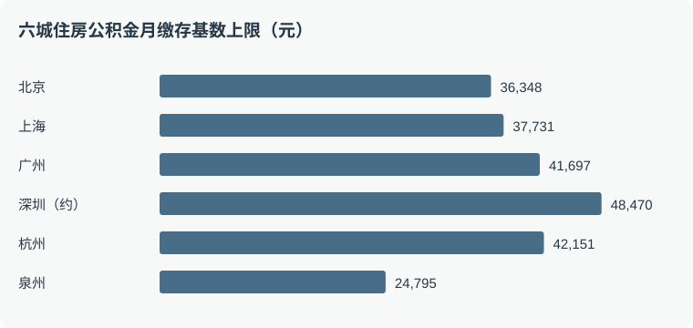
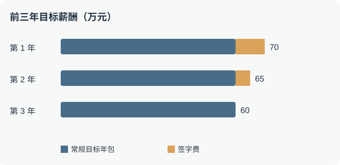
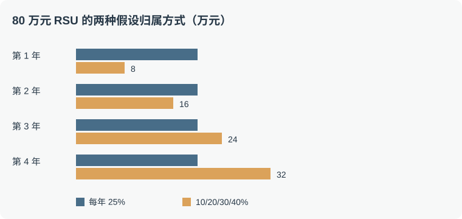
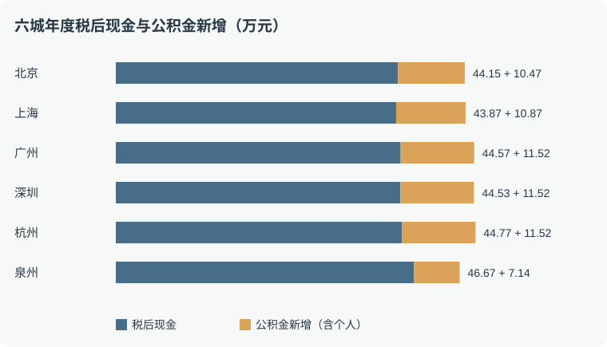

拿到两份 Offer：一家说年包 70 万，另一家说 43 万、六险二金。数字一眼能比，钱的性质却不同：有的每月到账，有的要等绩效，有的锁在公积金或年金账户里，还有的只是尚未兑现的股权估值。

这篇文章整理一套看懂薪酬的账本，适用于比较北京、上海、广州、深圳、杭州、泉州等地的互联网、AI 企业、国企和研究机构岗位。**文中金额均为示例，不代表企业报价；政策核对截至 2026 年 11 月 9 日。** 社保、公积金和税务细则会变化，签约前应按工作地和个人情况核实。

## 先把总包拆成五层

| 层次 | 典型项目 | 看什么 |
| --- | --- | --- |
| 固定现金 | 固定月薪、明确保底的工资 | 合同金额、发放月份、试用期待遇 |
| 浮动现金 | 年终奖、季度绩效、项目奖 | 目标值、考核规则、历史兑现情况 |
| 福利与保障 | 单位公积金、年金、补充医疗 | 公司承担多少、何时归属、能否使用 |
| 一次性收入 | 签字费、安家费、留任奖 | 税前金额、支付时间、追索条件 |
| 股权 | 股票、限制性股票单位、期权 | 归属、价格、行权和退出渠道 |

这些项目的确定性、流动性和风险不同，不宜用一个数字替代。单位缴纳的社保属于保障和用工成本，不能直接当成工资；个人缴存部分已经包含在税前工资内，不能再当作公司额外给的钱。

## 一、固定现金：Base 与税后工资

### 月薪、固定工资与总包

Base 通常指税前固定工资，但合同中的“基本工资”可能只是月度收入的一部分。问清岗位工资、津贴和月度绩效是否固定。

TC（Total Compensation，总包）一般包括固定工资、目标奖金和股权等，具体口径要问 HR。例如 42 万固定工资 + 14 万目标奖金 + 12 万当年计划归属股权，目标 TC 是 68 万；其中固定现金仅 42 万。还应区分目标值、实际兑现值和企业总用工成本。

调薪和一次性奖金也不同：40k 月薪上调 10% 至 44k，固定工资一年增加 4.8 万元，且可能影响之后的年度；一次性增加 4.8 万奖金只影响该次发放。

年薪相同、支付节奏不同，也会影响预算。48 万固定工资按月发和大额年终集中发，日常现金流并不相同；绩效奖金尚未兑现时，不应拿目标金额承诺每月支出。不同工资组成还可能影响缴费基数核定，不能假设所有补贴都进入基数。

### 个税：边际税率不是全年平均税率

居民个人综合所得适用超额累进税率。年度应纳税所得额一般由综合所得减去 6 万元基本减除费用、符合条件的社保公积金、专项附加扣除等得到。

| 年应纳税所得额 | 税率 | 速算扣除数 |
| --- | ---: | ---: |
| 不超过 3.6 万元 | 3% | 0 |
| 超过 3.6 万至 14.4 万元 | 10% | 2,520 元 |
| 超过 14.4 万至 30 万元 | 20% | 16,920 元 |
| 超过 30 万至 42 万元 | 25% | 31,920 元 |
| 超过 42 万至 66 万元 | 30% | 52,920 元 |
| 超过 66 万至 96 万元 | 35% | 85,920 元 |
| 超过 96 万元 | 45% | 181,920 元 |

#### 工资个税与专项附加扣除

年度应纳税所得额一般可写为：年度综合所得收入额 − 60,000 元基本减除费用 − 符合规定的社保公积金等专项扣除 − 专项附加扣除 − 其他依法确定的扣除。应纳税额再根据对应税率和速算扣除数计算；6 万元是计算时的减除费用，不是一笔额外发放的现金。年度综合所得还可能包括劳务报酬、稿酬和特许权使用费，具体收入额按各自规则确定。

符合条件时，常见的七项专项附加扣除包括：**3 岁以下婴幼儿照护、子女教育、继续教育、大病医疗、住房贷款利息、住房租金、赡养老人**。每项有自己的适用条件、标准和申报方式，不能只凭项目名称就认定可以扣除。

以符合条件的住房租金为例，北京、上海、广州、深圳、杭州通常适用每月 1,500 元标准；其他城市依政策分类，不能直接套用。以全年 18,000 元扣除且新增扣除全部落在 25% 边际税率档为例，税额减少 4,500 元，并非报销 18,000 元租金。扣除跨越税档时节税额需要分段计算。住房租金与住房贷款利息扣除还要遵守纳税人及配偶的适用限制，详见[税务部门的住房租金问答](https://shanghai.chinatax.gov.cn/tax/zcfw/rdwd/202603/t479656.html)。

##### 七项扣除：标准、对象与容易忽略的条件

下表依据截至 **2026 年 11 月 9 日**已公开政策整理。数额是符合条件时可从应纳税所得额中扣除的金额，**不是直接退还或补贴的现金**。

| 项目 | 主要标准 | 关键条件与分配 |
| --- | --- | --- |
| 3 岁以下婴幼儿照护 | 每个婴幼儿每月 2,000 元 | 从出生当月至满 3 岁前一月；父母可一方 100% 或双方各 50%，年度内方式不变 |
| 子女教育 | 每个子女每月 2,000 元 | 适用于规定的学前教育及全日制学历教育；父母可一方 100% 或双方各 50%，年度内方式不变 |
| 继续教育 | 境内学历（学位）继续教育每月 400 元，同一学历最长 48 个月；符合条件的职业资格继续教育，取得证书当年 3,600 元 | 须符合教育类型、取得证书和期限等规定；本人接受本科及以下学历继续教育符合条件时，可由本人或父母按规定选择扣除，不能重复 |
| 大病医疗 | 医保报销后符合规定的个人负担累计超过 15,000 元的部分，在每人每年 80,000 元限额内据实扣除 | 是医保目录范围内规定的自付部分；本人或配偶发生的费用可选由本人或配偶一方扣除，未成年子女费用可选由父母一方扣除，按患者分别计算；在年度汇算时办理 |
| 住房贷款利息 | 符合条件的首套住房贷款利息，每月 1,000 元，最长 240 个月 | 实际发生符合规定的首套住房贷款利息；夫妻通常约定由一方扣除，婚前各自首套贷款另有规定 |
| 住房租金 | 按主要工作城市类别每月定额 1,500、1,100 或 800 元 | 主要工作城市无自有住房且符合其他条件；夫妻在同一主要工作城市只能由一方扣除，房租和房贷扣除还受相关限制 |
| 赡养老人 | 独生子女每月 3,000 元；非独生子女与兄弟姐妹分摊每月 3,000 元，本人不超过 1,500 元/月 | 赡养年满 60 岁父母等符合规定的被赡养人；约定或指定分摊须留存书面协议，年度内分摊方式和额度不变 |

政策依据：[婴幼儿照护与子女教育标准](https://www.chinatax.gov.cn/chinatax/n810341/n810760/c5211365/content.html)、[继续教育及大病医疗](https://jiangsu.chinatax.gov.cn/art/2023/11/10/art_9280_439902.html)、[大病医疗扣除对象](https://tianjin.chinatax.gov.cn/11200000000/0300/030005/20260720094746189.shtml)、[住房贷款利息](https://shanghai.chinatax.gov.cn/tax/zcfw/rdwd/202602/t479564.html)、[住房租金](https://shanghai.chinatax.gov.cn/tax/zcfw/rdwd/202603/t479656.html)、[赡养老人](https://shanghai.chinatax.gov.cn/tax/zcfw/rdwd/202602/t479540.html)。例如父母都有养老金，并不当然影响符合条件的赡养老人扣除；父母的医疗费则不能直接作为子女的大病医疗扣除。

大病医疗举例：某患者全年符合规定的医保目录内自付部分为 30,000 元，超过 15,000 元的 15,000 元可按规定扣除；若金额为 110,000 元，超过部分是 95,000 元，但该患者扣除额受 80,000 元上限约束。是否符合要以医保结算记录与税务规定为准。

##### 用同一份工资算扣除节税：跨税档不能直接乘最高税率

以北京固定工资为假设：年薪 480,000 元，全年个人社保和公积金 98,175.60 元，基本减除费用 60,000 元；年终奖 120,000 元假设符合条件并另行单独计税。先只看工资综合所得，假设没有其他收入或扣除：

| 情景 | 可扣除的专项附加扣除 | 工资应纳税所得额 | 工资个税 | 相对无扣除少缴 |
| --- | ---: | ---: | ---: | ---: |
| 无专项附加扣除 | 0 元 | 321,824.40 元 | 48,536.10 元 | — |
| 符合条件的租房扣除 | 18,000 元/年 | 303,824.40 元 | 44,036.10 元 | 4,500.00 元 |
| 租房加一名子女教育，均由本人依法全额扣除 | 42,000 元/年 | 279,824.40 元 | 39,044.88 元 | 9,491.22 元 |

第三行并非 42,000 × 25% = 10,500 元：扣除后的应纳税所得额跨过 30 万元税档，其中 21,824.40 元按 25% 减税，其余 20,175.60 元按 20% 减税。这里是额外扣除依次抵减所得额的计算方式；不代表租房和教育各自存在不同的政策税率。具体家庭是否符合扣除、由谁申报须单独核实。

##### 同样月薪，为什么月度预扣税会变化？

工资通常按**累计预扣法**：当月应预扣税额 = 截至当月的累计应预扣税额 − 此前已预扣税额。继续假设每月工资 40,000 元、个人五险一金 8,181.30 元，每月 5,000 元基本减除费用，无专项附加扣除，全年无其他变化；这时每月增加的累计应纳税所得额是 26,818.70 元。

| 月份 | 累计应纳税所得额 | 累计应预扣税额 | 当月预扣税额 |
| --- | ---: | ---: | ---: |
| 第 1 月 | 26,818.70 元 | 804.56 元 | 804.56 元 |
| 第 2 月 | 53,637.40 元 | 2,843.74 元 | 2,039.18 元 |
| 第 6 月 | 160,912.20 元 | 15,262.44 元 | 4,373.09 元 |
| 第 12 月 | 321,824.40 元 | 48,536.10 元 | 6,454.96 元 |

表中当月税额减去的是**上一个月**的累计预扣税，即使表格没有展示该月。工资、公积金或扣除发生变化时，实际预扣也会变化；年度汇算还要合并全年综合所得，并按规定处理已预缴税额和其他因素。符合规定并选择单独计税的年终奖不并入上表工资所得。

##### 怎么申报、什么时候汇算？

- 在个人所得税 App 或自然人电子税务局填报扣除年度和相关信息；符合条件的项目可以按规定选择通过扣缴义务人预扣时享受，或在年度汇算时申报。**大病医疗在年度汇算时办理。**
- 提前和配偶、兄弟姐妹核对分摊；及时更新租赁、子女教育或家庭情况变化，并按要求留存合同、凭证或分摊协议备查。
- 需要办理综合所得年度汇算的，通常在取得所得的次年 **3 月 1 日至 6 月 30 日**办理；不是人人都必须汇算，是否需要申报及可否免于补税应按实际情形和当年公告判断。[税务总局汇算管理办法](https://shanxi.chinatax.gov.cn/web/detail/sx-11400-545-1805161)列明了需要办理和无需办理的情形。
- 忘了填符合条件的扣除，可按规定在汇算时补充；退税也不是“把扣除额退回来”，而是根据全年应纳税额与已预缴税额计算。需要补税的情形同样应按规定办理。[可补充的扣除](https://tianjin.chinatax.gov.cn/11200000000/0300/030005/20260506101227073.shtml)。

专项扣除之外，还有符合条件的**其他依法确定的扣除**。例如个人向个人养老金资金账户缴费，可在每年 12,000 元限额内据实扣除；账户资金有规定的领取条件，投资收益及领取环节另有税收规定。它不属于上述七项专项附加扣除，也不能将扣除额直接等同于税收优惠金额。[税务部门说明](https://guangxi.chinatax.gov.cn/nsfw/nszx/rdwd/202607/t20260701_435189.html)。

进入 30% 档，并不意味着全部收入都按 30% 缴税。月工资通常采用累计预扣，年底月度扣税可能增加；年度汇算再依法计算全年税额。

## 二、浮动现金：绩效、年终奖与兑现

### 额外几薪有多少能拿到？

“35k × 16”名义上是 56 万元：35,000 × 12 = 42 万元，加上目标 4 薪 14 万元。假设额外 4 薪按绩效系数 \(K\) 发放：

| 绩效系数 | 全年税前现金 | 相当于 |
| ---: | ---: | ---: |
| 0 | 42 万元 | 12 薪 |
| 0.5 | 49 万元 | 14 薪 |
| 1 | 56 万元 | 16 薪 |
| 1.5 | 63 万元 | 18 薪 |

试着调整目标奖金兑现系数，观察税前现金和相当于多少薪；滑块是假设示例，实际以公司方案为准。



实际规则以公司制度为准。值得问的是：**固定几薪、目标几薪，以及过去的实际发放情况。** 绩效等级的字母各公司含义不同；它可能影响奖金、调薪、晋升和股权刷新。PIP 是绩效改进计划，不必然意味着立即解除合同。

### 年终奖如何计税？

[全年一次性奖金政策](https://fgk.chinatax.gov.cn/zcfgk/c102416/c5211524/content.html)执行至 2027 年 12 月 31 日：符合条件的奖金可选择单独计税或并入综合所得；[每个纳税年度单独计税方法只能使用一次](https://shanghai.chinatax.gov.cn/tax/zcfw/rdwd/202501/t474844.html)。选择哪种更有利取决于个人情况。签字费、季度奖等不能仅因一次性发放就假定符合该政策。

单独计税时，先用全年一次性奖金除以 12，查对应的月度税率和速算扣除数，再用 **奖金总额 × 税率 − 速算扣除数**。假设年终奖为 12 万元，12 万元 ÷ 12 = 1 万元，对应 10% 税率和 210 元速算扣除数，因此税额为 11,790 元，税后奖金为 108,210 元。

按这种方法，某些税率档位交界处会出现税额跳升：奖金增加一点，税后反而可能减少。实际能否适用、应选单独还是合并，需按全年收入和可扣除项目在个税汇算时比较；不要要求企业仅为避开档位而改变真实所得性质。

## 三、福利与保障：五险一金和长期福利

### 五险一金：基数和比例都要看

五险通常指养老、医疗、失业、工伤、生育保险；一金指住房公积金。养老、医疗、失业一般有个人和单位缴费，工伤、生育通常由单位承担。具体比例、医保档次及缴费基数以当地规定为准，不能将一个城市的数字套到另一城市。

#### 每种保险解决什么问题

| 项目 | 个人通常缴纳 | 单位通常缴纳 | 权益与注意点 |
| --- | --- | --- | --- |
| 养老 | 通常按缴费基数的 8% | 通常按当地规定比例缴纳 | 个人账户与统筹共同影响退休待遇；退休金不能简单用缴费总和除以年数 |
| 医疗 | 通常缴纳，具体看当地制度和档次 | 按当地规定缴纳 | 个人账户和统筹基金用途不同；报销受目录、起付线和比例限制 |
| 失业 | 通常缴纳，费率因地而异 | 按当地规定缴纳 | 符合条件时提供失业保障 |
| 工伤 | 通常不缴 | 按规定缴纳 | 符合条件的工伤医疗与待遇保障，费率可能因行业而异 |
| 生育 | 通常不缴 | 按规定缴纳，许多地区与医保合并实施 | 符合条件时涉及生育医疗费用和生育津贴 |

这张表是常见职工参保情形，具体以参保地现行制度为准。试用期也应依法参保；缴得少可能让当前现金多一点，但不能据此认定保障更好。

##### 养老保险：退休后的基本收入

以缴费基数 20,000 元为例，个人按 8% 缴 1,600 元，单位按 16% 缴 3,200 元；个人部分记入个人账户，单位部分一般进入统筹基金。退休待遇涉及缴费年限、缴费水平、待遇领取地及个人账户等因素。个人账户养老金通常以退休时个人账户储存额除以计发月数计算；基础养老金另按规定计算。

按[渐进式延迟退休决定](https://www.gov.cn/yaowen/liebiao/202409/content_6974294.htm)，从 2030 年起，按月领取基本养老金的最低缴费年限由 15 年逐年提高 6 个月，2039 年达到 20 年。达到最低年限也要满足法定退休年龄等其他条件。

##### 医疗保险：门诊、住院和用药

个人账户可按规定用于符合条件的就医购药、家庭共济等；统筹基金支付符合待遇范围的医疗费用。以假设的 10,000 元医疗账单为例：其中 8,000 元属于政策范围，扣除假设的 1,000 元起付线后，按假设的 80% 支付，统筹基金支付 5,600 元，其余 4,400 元由个人或其他渠道承担。具体报销需看参保地、医院、目录和限额；这些数字只是算术演示。

##### 失业保险：收入中断时的缓冲

符合条件的失业人员可领取失业保险金，并按规定享有领取期间的医保保障。一般需满足失业前单位和本人已缴费满一年、非因本人意愿中断就业、依法办理失业登记并有求职要求等条件；是否符合以经办机构认定为准。主动辞职通常不符合非本人意愿条件，但具体解除情形须按规定判断。

失业金不是原工资的固定百分比。[深圳 2026 年 9 月待遇期起](https://www.sz.gov.cn/ztfw/shbz/wyk_183996/content/mpost_12981985.html)，标准为最低工资 2,700 元的 90%，即 2,430 元/月；领取期限依缴费年限等确定。

##### 工伤和生育保险：单位缴费，按条件享受待遇

工伤保险可能涉及工伤医疗、康复、伤残与工亡待遇。依法认定的停工留薪期内原工资福利待遇按规定由单位支付。生育保险涉及符合条件的生育医疗费用与生育津贴；男职工也应按规定参保，个人及配偶的待遇以当地规则为准。两项通常由单位缴费，职工个人不另缴。

一般的计算形式是：**月缴费额 = 核定缴费基数 × 缴费比例**。基数通常与上年工资性收入有关，并受当地上下限约束；新入职人员的核定办法可能不同。社保和公积金的口径、上下限及调整时间也可能不同。

养老保险个人缴费形成个人账户权益；单位缴费一般进入统筹基金。医保也有个人账户和统筹基金。它们提供保障与未来权益，不能视为随时可支取的存款。

住房公积金则由个人和单位分别缴存，进入职工个人账户，但提取和贷款需要符合当地条件。以月缴存基数 30,000 元、双方比例相同为例：

| 双方比例 | 个人月缴 | 单位月缴 | 账户全年新增 |
| --- | ---: | ---: | ---: |
| 5% + 5% | 1,500 元 | 1,500 元 | 3.60 万元 |
| 7% + 7% | 2,100 元 | 2,100 元 | 5.04 万元 |
| 10% + 10% | 3,000 元 | 3,000 元 | 7.20 万元 |
| 12% + 12% | 3,600 元 | 3,600 元 | 8.64 万元 |

调整同一基数下的双方缴存比例，分别看个人、单位和账户新增金额。示例假设双方比例相同、全年基数不变；各地和公司规定可能不同。



从 5% 提到 12%，账户每年多 5.04 万元，其中公司多缴 2.52 万元，个人也多缴 2.52 万元。后者原本就是工资的一部分，现金到手会相应减少；实际税后差额还受个税影响。基数不同时，光看比例也会误判。

#### 单位说“按规定缴纳”，怎么核对？

1. 保存劳动合同、工资条、奖金发放记录，核对上一年度依法计入缴费工资的收入；新入职人员另按当地规则确定。
2. 在[国家社会保险公共服务平台](https://si.12333.gov.cn/)或当地人社、医保渠道查询参保地、各险种缴费月份、申报基数和缴费记录，再在公积金中心查询缴存基数、比例及单位到账额。
3. 将应核定工资与当地各险种上下限逐项比较：低于下限按规定使用下限，高于上限按上限；基数为下限本身不必然违法，关键是核定工资和适用规则。
4. 有差异时向 HR 索取核定依据；未解决时可联系参保地社保、医保、公积金部门或 12333 咨询。缴费记录、合同和工资凭证比口头承诺更有用。

依法缴纳社保不能简单靠员工签字放弃；[最高法司法解释](https://www.court.gov.cn/fabu/xiangqing/472691.html)明确相关约定的效力。按最低基数缴纳是否属于少缴，需要先查清真实核定工资、险种和政策年度。

### 六座城市，核对什么

| 工作地 | 谈 Offer 时应特别核对 |
| --- | --- |
| 北京 | 社保和公积金各自的核定基数、比例及政策年度 |
| 上海 | 普通公积金与补充公积金是否都缴、双方比例各多少 |
| 广州 | 养老、医保和公积金是否使用不同基数上限 |
| 深圳 | 医保参保档次、个人和单位公积金比例、当地提取规则 |
| 杭州 | 社保与公积金各项基数、缴存比例及使用条件 |
| 泉州 | 工作区县对应的公积金缴存基数下限、单位比例及社保基数 |

例如，北京 [2026 公积金年度](https://www.beijing.gov.cn/zhengce/zcjd/202608/t20260825_4835519.html)为 2026 年 7 月至 2027 年 6 月，月缴存基数上限 36,348 元，一般缴存比例 5%—12%。[上海社保](https://rsj.sh.gov.cn/tdjjf_17554/20260824/t0035_1443297.html)自 2026 年 7 月起的月基数上限为 37,731 元，这个数字不能直接代替公积金上限。[深圳规定](https://zjj.sz.gov.cn/zcjzts/)公积金上限按上一年度全市在岗职工月平均工资的三倍确定；个人可按规定选择高于单位的缴存比例。

[泉州住房公积金政策](https://qzgjj.quanzhou.gov.cn/zwgk/zfxxgk/fdzdgknr/zcfggfxwj/202607/t20260706_3306842.htm)规定，2026 年 7 月至 2027 年 6 月最高月缴存工资基数为 24,795 元；市直及鲤城、丰泽等区县的下限为 2,195 元，安溪、永春和德化为 2,045 元。基数上限并不意味着每个人都按上限缴存，具体以核定情况为准。

所谓“交得高”，既要看依法核定的基数，也要看单位实际缴存比例和补充福利。依法缴纳社保是基本要求；对公积金和年金的比较则需要核对具体方案。房租、生活成本和岗位发展也会改变跨城比较的结果。

#### 2026 年 11 月六城职工社保费率

下表为普通企业职工示例，各项为**单位 / 个人**，比例作用于对应核定基数，不一定都乘以当月 Base。单位医保一栏含表内说明的生育部分；工伤由单位缴纳，按行业风险和浮动规则核定。

| 城市 | 养老 | 医保及生育 | 失业 | 工伤 |
| --- | --- | --- | --- | --- |
| 北京 | 16% / 8% | 9.8% / 2% + 3 元 | 0.5% / 0.5% | 单位按行业费率，个人 0 |
| 上海 | 16% / 8% | 9% / 2% | 0.5% / 0.5% | 单位按行业费率，个人 0 |
| 广州 | 16% / 8% | 6.85% / 2% | 0.8% / 0.2% | 单位按行业费率，个人 0 |
| 深圳 | 16% / 8% | 一档 6.5% / 2% | 0.8% / 0.2% | 单位按行业费率，个人 0 |
| 杭州 | 16% / 8% | 9.5% / 2% | 0.5% / 0.5% | 单位按行业费率，个人 0 |
| 泉州 | 16% / 8% | 7.5% / 2% | 0.5% / 0.5% | 单位按行业费率，个人 0 |

依据：[北京社保](https://www.bjfsh.gov.cn/zsk/zcwd/202608/t20260818_40116625.shtml)、[北京医保](https://www.bjsjs.gov.cn/gongkai/zwgkpd/ztzl/2024/mtyfz/ybzcxwd/202410/t20241021_86349.shtml)、[上海医保](https://shanghai.chinatax.gov.cn/zcfw/zcfgk/sbf/202603/t479836.html)、[广州医保](https://wx12345.gzonline.gov.cn/km/showMsg?id=BEAFDBCFD)、[深圳医保](https://hsa.sz.gov.cn/gkmlpt/content/12/12567/post_12567884.html)、[杭州医保](https://www.hzzx.gov.cn/cshz/content/2025-10/16/content_9103412.htm)、[泉州医保](https://qzybj.quanzhou.gov.cn/zwgk/zfxxgk/fdzdgknr/sgfxwj/202301/t20230105_2834185.htm)及[福建失业](https://www.fzja.gov.cn/xjwz/zwgk/zfxxgkzdgz/jycy/zccs/202509/t20250903_5070513.htm)。其他比例及险种以当地实际经办和政策为准，工伤不统一假定为 0.2%。

深圳一档单位 6.5% 包含基本医保 6% 和生育 0.5%；二档基本医保为单位 1.5%、个人 0.5%，生育单位另缴，实际档次以参保情况为准。深圳户籍职工还涉及单位地方补充养老缴费，详见[深圳相关规定](https://hrss.sz.gov.cn/szsi/sbjxxgk/zcfggfxwj/zcfg/ylbx/content/post_8207598.html)。上海单位 9% 包含 8.5% 基本医保（含生育）和 0.5% 地方附加医保。广州单位 6.85% 中基本医保 6%、生育 0.85%；杭州单位 9.5% 含生育 0.6%。

#### 同一缴费工资下，单位和个人每月各交多少？

沿用后文六城示例中**每项依法核定工资为 40,000 元/月、各险种分别受上限约束**的设定，下表只计算五险，暂不含公积金。单位工伤统一假设费率 0.2%、基数取本表养老基数；这是便于演示的假设，实际单位工伤基数按规定核定、费率由行业与浮动规则决定。深圳假设非深户、医保一档，泉州按文中标准职工费率演示。单位实际缴费基数亦可能按照单位职工工资基数之和或其他规定核定，以下不是用工成本报价。

| 城市 | 个人五险 | 单位养老 | 单位医保含生育 | 单位失业 | 假设单位工伤 | 单位合计 |
| --- | ---: | ---: | ---: | ---: | ---: | ---: |
| 北京 | 3,819.54 | 5,815.68 | 3,562.10 | 181.74 | 72.70 | 9,632.22 |
| 上海 | 3,961.76 | 6,036.96 | 3,395.79 | 188.66 | 75.46 | 9,696.87 |
| 广州 | 2,911.64 | 4,416.48 | 2,135.15 | 320.00 | 55.21 | 6,926.84 |
| 深圳 | 2,960.90 | 4,416.48 | 2,186.15 | 320.00 | 55.21 | 6,977.84 |
| 杭州 | 2,689.16 | 4,097.76 | 2,433.05 | 128.06 | 51.22 | 6,710.09 |
| 泉州 | 2,403.77 | 3,662.88 | 1,716.98 | 114.47 | 45.79 | 5,540.12 |

例如北京，单位养老 36,348 × 16% = 5,815.68 元，医保含生育 36,348 × 9.8% = 3,562.10 元，失业 181.74 元，假设工伤 72.70 元，合计约 9,632.22 元/月。项目逐项四舍五入，实际账单可能略有差异。个人和单位缴费属于不同账本，不能把单位社保全部理解成个人账户余额。

#### 六城各险种缴费基数上下限

以下为截至 2026 年 11 月已公布、对普通职工适用的月基数范围（元）；**不同险种生效时间不同**，尤其泉州失业保险为 2026 年 10 月起。工伤以单位及险种规则单独核定，不直接套用此表。

| 城市 | 养老 | 医保及生育 | 失业 |
| --- | --- | --- | --- |
| 北京 | 7,270–36,348 | 7,270–36,348 | 7,270–36,348 |
| 上海 | 7,546–37,731 | 7,546–37,731 | 7,546–37,731 |
| 广州 | 5,521–27,603 | 6,234–31,170 | 2,680–42,933（参考值） |
| 深圳 | 5,521–27,603 | 6,727–33,633 | 2,700–48,471（参考值） |
| 杭州 | 5,122–25,611（参考值） | 5,122–25,611（参考值） | 5,122–25,611（参考值） |
| 泉州 | 4,579–22,893 | 4,579–22,893 | 4,579–22,893 |

北京、上海、广东养老、广州医保、深圳医保和泉州的官方依据见下方六城算例。广州、深圳失业及杭州基数引用[广州整理](https://gz.bendibao.com/life/202519/355895.shtml)、[深圳整理](https://m.bendibao.com/bsy616048.html)、[杭州整理](https://hz.bendibao.com/live/2026109/173298.shtm)，相关数值需以当地经办系统核定为准。

例如深圳核定工资 40,000 元，养老基数为 27,603 元，医保一档为 33,633 元，失业为 40,000 元；不同基数本身不说明少缴。

#### 六城公积金上限：先看基数，再看单位缴存

下表为 **2026 年 7 月至 2027 年 6 月**的住房公积金年度口径，单位为元/月；政策更新和核定规则请以当地公积金中心为准。上限不是平均水平，也不是每家公司都按顶格缴存。

| 城市 | 月缴存基数上限 | 上限情景下单位年缴额 | 说明 |
| --- | ---: | ---: | --- |
| [北京](https://www.beijing.gov.cn/zhengce/zcjd/202608/t20260825_4835519.html) | 36,348 | 约 52,341 元 | 假设单位 12% |
| [上海](https://www.shanghai.gov.cn/gwk/affairs/content/0064%40f3d788ec72e9404ebcbf3d27fda98435) | 37,731 | 普通 7% 约 31,694 元；另加补充 5% 合计约 54,333 元 | 补充公积金由单位自愿参加 |
| [广州](https://hrlib.ciic-cloud.cn/news/info?id=01m0yscpk4e65y2n50nwchhd34) | 41,697 | 约 60,044 元 | 假设单位 12%；链接为公积金中心通知转载 |
| [深圳](https://www.sz.gov.cn/hdjl/ywzsk/jsj/zfgjj/content/post_12893587.html) | 约 48,470 | 约 69,797 元 | 按市统计局公布的 2025 年在岗职工年均工资 193,881 元 ÷ 12 × 3 估算，取整以中心核定为准 |
| [杭州](https://hznews.hangzhou.com.cn/jingji/content/2026-07/25/content_9263759.htm) | 42,151 | 约 60,697 元 | 假设单位 12%；链接转载中心通知 |
| [泉州](https://qzgjj.quanzhou.gov.cn/zwgk/zfxxgk/fdzdgknr/zcfggfxwj/202607/t20260706_3306842.htm) | 24,795 | 约 35,705 元 | 假设单位 12% |

上表用“基数上限 × 假设单位比例 × 12”估算，未逐月取整；上海补充公积金不保证每家单位都有。深圳推算依据是[市统计局公布的工资数据](https://www.sz.gov.cn/cn/xxgk/zfxxgj/tjsj/tjgb/content/mpost_12907800.html)，它与原对话给出的约 48,471 元存在取整差异，因此这里只给约数。

上海写的“7% + 5%”是**每一方**普通公积金 7% 加补充公积金 5%；如果单位和个人都这样缴，各为 12%，双方合计 24%。相同工资下，实际入账仍由经核定的基数和比例决定。广州与深圳的[企业职工养老保险基数上限](https://guangdong.chinatax.gov.cn/gdsw/mmsw_gkwj/2026-10/13/content_87b090a21cbb45a3b8adb477f596793a.shtml)自 2026 年 7 月起为 27,603 元/月，明显不同于公积金上限，也不能代替医保的基数上限。

**如何看出待遇是否较好？** 先确认依法核定的工资基数，再比较单位公积金、补充公积金、年金和医疗保险。单位以偏低的基数长期缴纳而不给出依据时，应要求核对；对工资构成、新入职口径及上下限的适用有疑问，可向当地主管部门咨询。

#### 六城公积金怎么提取？先看租房，再看购房与还贷

上面的缴存额不等于每月可自由支取的现金。下面对比截至 **2026 年 11 月 9 日**查到的政策，以本地缴存的普通职工常见情形为主。提取资格、额度、账户余额、缴存时间、家庭成员范围及同一期间其他提取记录都可能影响结果；具体以相应公积金中心审核为准。表中“个人”和“家庭”口径不能直接混算。

| 城市 | 常见租房提取 | 频次与需要注意的条件 |
| --- | --- | --- |
| [北京](https://gjj.beijing.gov.cn/web/zwgk61/2024zcwj/436433464/436433466/436439104/index.html) | 租住商品住房，无租房发票时按规定每人每月 2,000 元；提供发票并完成租赁合同备案，可按实际租金提取，一般受月缴存额限制 | 申请人连续足额缴存满 3 个月，且本人及配偶在北京无自有住房并租房。可办理按月提取；多子女家庭、公共租赁住房和保障性租赁住房有按规定实际房租提取的特殊规则。 |
| [上海](https://service.shanghai.gov.cn/XingZhengWenDangKuJyhTest/XZGFDetails.aspx?docid=241015151102JbADRZpu6KkOIFz6TBv) | 市场租赁住房一般每户家庭（含单身家庭）每月最高 4,000 元；保障性租赁住房按实际房租支出 | 市场租赁一般不超过实际房租；自 2024 年 11 月起新申请可按月办理。符合条件的新市民或 35 周岁及以下青年人，租赁合同网签备案后可按实际房租提取；高层次人才另有规则。 |
| [广州](https://www.gz.gov.cn/attachment/7/7899/7899488/10482888.pdf) | 无租赁合同或合同未备案的无房租赁定额为每人每月 2,000 元；租赁合同备案等情形有不同的核定办法 | 连续足额缴存满 3 个月等条件适用；[办事指南转载](https://m.gz.bendibao.com/life/371625_2.html?src=amap)列为每 3 个月可提一次，多子女家庭有上浮。2026 年提出的调至 2,500 元等内容属于[征求意见稿](https://house.cnr.cn/kcb/20260923/t20260923_527822728.shtml)，本次未查到正式落地文件，不能当作现行定额。 |
| [深圳](https://zjj.sz.gov.cn/xxgk/ztzl/rrkt/index.html) | 2025 年 11 月 1 日至 2027 年 10 月 31 日期间，符合无房租房条件的缴存职工，可按月应缴存额的 80% 计算该期间提取额度 | 普通情形通常要求职工本人及家庭成员在当地无房；每月可办理一次。多子女家庭、公租房和保租房有单独规则；跨政策时段的月份要分段计算。 |
| [杭州](https://zfgb.hangzhou.gov.cn/upload/default/bigfile/2025/06/11/20250611_9ab274879df247f9bcdc8a367966e83c.pdf) | 无房租赁定额：杭州市区 2,000 元/月，桐庐、淳安、建德 1,200 元/月 | 新市民或 35 周岁及以下青年人在本市无房并通过市场租赁住房的，可按规定全额提取本人每月缴存的公积金；保障性租赁住房按规定凭备案合同、按实际房租支出提取。可每年一次或约定按月，最多计算 12 个月。 |
| [泉州](https://qzgjj.quanzhou.gov.cn/zwgk/fgwj/zcjd/202605/t20260529_3295800.htm) | 职工家庭在公积金缴存地无自有住房且租住商品住房，职工每人每月额度 1,500 元；生育、抚养两个及以上子女的职工家庭为每月 1,700 元 | 2026 年调整政策自发文之日起实施。该中心的部分旧办事指南仍显示每年 12,000 元，办理时应以 2026 年新政策及中心核定为准；可咨询中心是否符合[逐月冲房租](https://qzgjj.quanzhou.gov.cn/bsfw/bszn/gjjtqzn/202408/t20240829_3076347.htm)。 |

深圳的“月应缴存额”包含单位和个人部分，而不是只算个人扣款。例如双方各缴 4,800 元，月应缴存额为 9,600 元；若满足普通租房条件且对应月份处于上述阶段性政策期内，按 80% 计算为 **7,680 元/月**。这只是额度计算示例，还要看可提取月份、账户余额及申请核定。[深圳住建局解释](https://zjj.sz.gov.cn/szszfhjsjwzgkml/szszfhjsjwzgkml/ywzsk/zfgjj/content/post_12703799.html)。

##### 购房、还贷和其他提取情形

- **北京**：使用北京中心公积金贷款（含组合贷款）购房，可按[购房提取操作指引](https://gjj.beijing.gov.cn/web/zwfw5/386727/386730/386732/11098723/index.html)申请；贷款和提取的关系、可提额度按具体业务核定。2026 年规定符合条件的本市自住住房装修可凭合规发票提取，额度受发票金额及上限约束，见[政策原文](https://gjj.beijing.gov.cn/web/zwgk61/2024zcwj/436433464/436433467/744089355/index.html)。
- **上海**：符合条件的本市新建商品住房现房购房人，可按规定申请提取本人及配偶公积金支付首付款；资格、网签备案与已有提取业务限制见[2026 年通知](https://www.shanghai.gov.cn/gwk/affairs/content/0064%40d3264980afe6482085504c6a56fb41ce)。符合条件的长三角异地公积金贷款还贷也有对应提取安排，见[中心答复](https://www.shanghai.gov.cn/nw17239/20260721/558c1a9742ab41918268fae8073a212d.html)。
- **广州**：购房和偿还贷款可按住房地点、购房方式、贷款状态等不同规则申请；符合条件的本市购房首付款也可办理提取。可从[广州中心首付款业务材料](https://gjj.gz.gov.cn/attachment/7/7643/7643577/9792017.pdf)和[市人社业务入口说明](https://rsj.gz.gov.cn/zzzq/shbz/gzsshbzk/yyzy/content/post_8730072.html)核对具体路径。不要把征求意见中的全国异地购房提取视为已经普遍适用。
- **深圳**：符合购房首付款提取条件时，首套可提金额不超过账户余额和首付款，第二套不超过账户余额 60% 且不超过首付款，详见[住建局说明](https://zjj.sz.gov.cn/szszfhjsjwzgkml/szszfhjsjwzgkml/ywzsk/zfgjj/content/post_12752620.html)。符合条件者可签订[还贷委托提取协议](https://zjj.sz.gov.cn/hdjl/ywzs/content/post_12893678.html)按月还贷。
- **杭州**：符合条件的购房、还贷等可依规定申请；购买本市自住住房并支付契税，符合条件的缴存人及配偶可按规定提取，合计不超过实际契税，见[2026 年通知](https://zfgb.hangzhou.gov.cn/11/103220263/t130220263034/530322.shtml)。
- **泉州**：在福建省内购买符合条件的自住住房，购房人及配偶的父母、子女可按规定申请“代际互助”提取；二手房、抵押及监管账户有不同条件，见[泉州中心政策解读](https://qzgjj.quanzhou.gov.cn/zwgk/fgwj/zcjd/202605/t20260529_3295800.htm)。

离职、退休、出境定居以及当地规定的其他情形可能涉及封存、转移或销户提取，条件因地而异，**离职不自动等于可以立即全部提取**。准备提取时，先确认具体缴存中心（含省直、中央等分中心）、账户状态、住房所在地与家庭资格，再通过中心官网、政务平台或 12329 核对材料和限额。提取还可能影响按账户余额计算的公积金贷款额度，例如[深圳贷款额度规则](https://zjj.sz.gov.cn/hdjl/ywzs/gjj/content/post_12798776.html)，做决定前应一起计算。

这里的公积金**提取额度**与上一节个税的**住房租金专项附加扣除额**属于两套制度：前者是符合条件后从自己的公积金账户提取的资金，后者是计算应纳税所得额时的扣除，不能把每月 2,000 元公积金提取额当成每月 2,000 元个税抵扣。

### 六险二金与长期福利

“六险二金”不是统一的法定套餐。第六险可能是补充医疗，第二金可能是企业年金或职业年金。看清具体方案、覆盖范围、免赔额、报销比例、医院和家属范围。

企业年金是在基本养老保险之外建立的补充养老制度。依据[企业年金办法](https://www.mohrss.gov.cn/xxgk2020/gzk/gz/202112/P020211230641789213268.pdf)，企业缴费每年不超过本企业职工工资总额的 8%，企业和个人合计不超过 12%；这不是每个人都必然按 8% + 4% 缴纳。假设个人基数 2 万元、单位 8%、个人 4%，每年分别缴 19,200 元和 9,600 元。单位部分可能有归属期限，离职时可保留多少要看方案。职业年金主要面向机关事业单位相关人员，普通国企员工不会因企业所有制自动拥有事业编制或职业年金。

职业年金和企业年金有不同的制度基础。[职业年金办法](https://gks.mof.gov.cn/guojijiejian/201806/P020180621597339944974.pdf)规定，适用的机关事业单位按工资总额 8% 缴费，个人按缴费工资 4% 缴费，按规定计入个人职业年金账户；单位缴费的记账和资金落实方式需依单位类型及规定判断。

#### 年金归属和补充医疗，问到什么程度

在前面的假设中，年金账户每年进入 28,800 元，其中 19,200 元来自公司，9,600 元来自个人。它是一项长期养老安排，不能像活期存款随意领取；投资收益和单位缴费的归属都可能影响离职后权益。[中央企业年金意见](https://wap.sasac.gov.cn/n2588035/n2588320/n2588335/c20235138/content.html)允许方案对单位缴费逐步归属作出安排，完全归属期限最长不超过 8 年；具体比例看本单位方案。

补充医疗应索取保障摘要：普通门诊是否覆盖？免赔额多少？基本医保结算后报销比例多少？私立医院、特需部、处方药和家属是否纳入？年度上限及等待期是什么？保费由谁承担？不清楚这些，无法把“有商业医疗”换算成可靠的现金价值。

## 四、一次性收入：签字费与补贴

签字费是加入公司的奖励，可能入职后、试用期后或分年发放。它可能已经包含在 HR 所说的首年总包里，别重复计算。留意服务期、提前离职时的退还比例、税前还是税后追索，以及税务申报如何处理。安家费、搬迁补贴、租房补贴、留任奖金、补偿原公司未归属股票的 make-whole、推荐奖、项目奖和科研奖励，都要逐项确认条件；报销与现金补贴也不能简单假定税务待遇相同。

假设常规目标年包每年 60 万，第一、二年签字费分别 10 万和 5 万：

三年目标合计 195 万，平均每年 65 万；稳定期目标年包仍是 60 万。比较时同时列出首年、三年平均和签字费结束后的金额。图中不考虑调薪、股价变化和绩效波动。

### 其他补贴逐项拆开

| 项目 | 常见目的 | 需要问清 |
| --- | --- | --- |
| 安家费、搬迁补贴 | 跨城落户、搬家或人才引进 | 现金还是凭票报销、分几年发、离职是否退还 |
| 租房补贴 | 支付居住成本 | 发放期限、是否和人才补贴重复、纳税口径 |
| 留任奖金 | 在约定日期仍在职时支付 | 到期条件、考核条件、提前离职处理 |
| 补偿性奖金 | 补偿跳槽损失的原公司奖金或股票 | 补偿依据、付款日期、是否附带服务期 |
| 推荐、项目和科研奖励 | 完成招聘、项目或科研目标 | 获奖条件、发放上限、是否可持续 |

举例：公司说“首年 70 万”，如其中 10 万是签字费、其余是 60 万目标年包，首年是 70 万，不能再加一次签字费。现金补贴和凭票报销的税务处理可能不同；离职退还税前签字费时，扣过的税款如何处理也需事先核实。

## 五、股权：股票、RSU 与期权

股票是持有的股份；RSU 是满足约定条件后取得股票的承诺；期权是未来以约定行权价购买股份的权利；ESOP 是员工持股安排，具体权利以计划文件为准。

假设授予时估值 80 万元的 RSU 分四年归属：均分时每年 20 万；按 10% / 20% / 30% / 40% 归属时，分别为 8 / 16 / 24 / 32 万。它们是授予时估值，实际价值取决于股价、归属与出售条件。未归属部分离职后如何处理、是否有年度刷新授予，都要查协议。

期权要扣行权成本。例如 1 万份期权、行权价 5 元，若全部归属且能以 20 元卖出，忽略税费时潜在收益为 1 万 × (20 − 5) = 15 万元，行权需 5 万元。未上市公司尤其需要问清融资、稀释、行权期限、离职后的行权窗口、回购或退出渠道。没有交易机会，估值无法直接当现金花。股权税务依形式、公司及交易时点而异，应核对适用政策。

### 期权价值随股价怎么变化

以下交互假设 10,000 份期权全部归属、可行权且能立即按所选价格出售，行权价 5 元/份；只在股价高于行权价时假设行权。图中的收益为税费、交易限制和时间成本之前的理论情景，不代表存在实际退出渠道。



### 一张表看清归属曲线

| 年度 | 平均归属 25% | 前低后高 10% / 20% / 30% / 40% |
| --- | ---: | ---: |
| 第一年 | 20 万元 | 8 万元 |
| 第二年 | 20 万元 | 16 万元 |
| 第三年 | 20 万元 | 24 万元 |
| 第四年 | 20 万元 | 32 万元 |

这里用 80 万元授予时估值说明归属顺序，未计税或股价变化。首次授予（initial grant）结束后，如无刷新授予（refresh grant），后续年份股权收入可能下降。Cliff 指首次归属前需满足的等待条件：例如等待一年才首次归属，并不表示离职时此前每月都已经拥有相应股份。

期权还应确认授予数量是公司总股本的多少、是否受后续融资稀释、离职后行权窗口、行权资金和无法退出时的损失。现金预算中可以把未上市股权单独列为高不确定性项目。

股权激励的纳税时间和金额也需要分开看。根据[上市公司股权激励个税政策](https://fgk.chinatax.gov.cn/zcfgk/c102416/c5211082/content.html)，符合条件的收入可在 2027 年 12 月 31 日前全额单独适用综合所得税率表，同一年度多次符合条件的收入需合并计算。对符合规定并备案的[境内上市公司股权激励](https://guangdong.chinatax.gov.cn/gdsw/zjfg/2024-04/28/content_ec4f1ff298e04296acc11866d22fb710.shtml)，可按规定在不超过 36 个月内缴税；期间离职应按规定在离职前缴清。分期安排不能无条件套用于境外上市公司。

## 综合比较：把五层放在一张账本里

### 薪酬计算器：Base、年终奖和签字费

选择城市并填写金额后，一张饼图会展示 Base、年终奖和签字费的收入去向；可在月均与全年之间切换，分别查看各项的税前、分摊个税和税后现金。金额输入采用 k（千元），例如月 Base 40k 填 40、年终奖 12 万元填 120；计算结果以元显示。工作城市默认上海，个人与单位公积金比例各默认为 12%，签字费默认为 100k；默认勾选全年住房租金扣除，仅在本人符合条件时保留，可展开修改。默认基数按各城上、下限对核定月缴费工资进行示意计算；实际各险种基数不同时，可展开并逐项修改。签字费假设并入工资薪金，年终奖可选择符合条件的单独计税或并入综合所得。



### 六城税后收入：同一份 60 万元 Offer 逐项计算

下面把北京、上海、广州、深圳、杭州和泉州放进同一套可复核的假设，并列出每个险种的缴费基数。**这是按 2026 年 11 月已知政策做的 12 个月静态年化情景，不是 2026 自然年的实际工资单。**

共同假设：居民个人全年连续任职；今年税前固定工资为每月 40,000 元、全年 480,000 元，年终奖 120,000 元全部兑现且符合全年一次性奖金单独计税条件。假设各城上年度按各险种规定核定的月平均缴费工资均为 **40,000 元**，新一年工资和年终奖不自动改变该假设。各城市均按此数受各自上下限约束：这并不意味着年终奖不纳入下一年度工资基数；若上年工资加奖金计入缴费工资总额，实际基数可能更高。

为了让城市之间可直接比较，**六城均只扣除每年 60,000 元基本减除费用，不计租房、赡养老人等专项附加扣除**。假设公积金个人与单位各 12%；上海对应普通 7% + 补充 5%，需单位确实建立补充公积金。深圳使用职工医保一档；工伤、生育由单位缴纳，个人记为零。本例不含年金、补充保险、其他税前扣除及可能存在的地方附加项目。北京另计每月 3 元大额医疗互助费用。

#### 每月个人缴费明细

金额单位：元。每个项目以“核定基数 × 个人费率”列示；各项先计算到分，便于复核。上海公积金为普通和补充合并计算，实际经办机构分项取整后可能有少量差异。

| 城市 | 养老 | 医疗 | 失业 | 个人公积金 | 每月合计 |
| --- | ---: | ---: | ---: | ---: | ---: |
| 北京 | 36,348 × 8% = 2,907.84 | 36,348 × 2% + 3 = 729.96 | 36,348 × 0.500% = 181.74 | 36,348 × 12% = 4,361.76 | 8,181.30 |
| 上海 | 37,731 × 8% = 3,018.48 | 37,731 × 2% = 754.62 | 37,731 × 0.500% = 188.66 | 37,731 × 12% = 4,527.72 | 8,489.48 |
| 广州 | 27,603 × 8% = 2,208.24 | 31,170 × 2% = 623.40 | 40,000 × 0.200% = 80.00 | 40,000 × 12% = 4,800.00 | 7,711.64 |
| 深圳 | 27,603 × 8% = 2,208.24 | 33,633 × 2% = 672.66 | 40,000 × 0.200% = 80.00 | 40,000 × 12% = 4,800.00 | 7,760.90 |
| 杭州 | 25,611 × 8% = 2,048.88 | 25,611 × 2% = 512.22 | 25,611 × 0.500% = 128.06 | 40,000 × 12% = 4,800.00 | 7,489.16 |
| 泉州 | 22,893 × 8% = 1,831.44 | 22,893 × 2% = 457.86 | 22,893 × 0.500% = 114.47 | 24,795 × 12% = 2,975.40 | 5,379.17 |

**依据和边界：** 北京[社保基数](https://www.beijing.gov.cn/zhengce/zcjd/202608/t20260821_4831683.html)；上海[社保基数](https://rsj.sh.gov.cn/tdjjf_17554/20260824/t0035_1443297.html)与[公积金比例](https://www.shanghai.gov.cn/gwk/affairs/content/0064%40f3d788ec72e9404ebcbf3d27fda98435)；广州和深圳的[广东养老基数](https://guangdong.chinatax.gov.cn/gdsw/mmsw_gkwj/2026-10/13/content_87b090a21cbb45a3b8adb477f596793a.shtml)、[广州医保](https://wx12345.gzonline.gov.cn/km/showMsg?id=BEAFDBCFD)、[深圳医保](https://hsa.sz.gov.cn/gkmlpt/content/12/12567/post_12567884.html)及[广东失业保险规则](https://rsj.gz.gov.cn/zcfg/flfg/content/post_10241930.html)；[杭州社保基数](https://hz.bendibao.com/live/2026109/173298.shtm)为政策信息转载；泉州[养老和失业基数](https://rst.fujian.gov.cn/zw/ztzl/zxzt/sbhm/zxsl/zcfg/202610/t20261008_7221778.htm)及[医保基数](https://www.quanzhou.gov.cn/zfb/xxgk/zfxxgkzl/qzdt/qzyw/202606/t20260630_3304627.htm)。各地公积金基数见第三部分的六城对照。广东职工失业个人费率本例使用 0.2%，其余城市使用 0.5%；请以实际参保地申报核定为准。

泉州 22,893 元的失业保险基数上限按该省通知自 2026 年 10 月起适用；北京、上海和广东企业养老等基数也有各自启用日期。把这组已知参数乘 12 是为了比较一年完整运行时的水平，**不能回填为各城 2026 年 1—12 月实际缴费**。

#### 年度个税与税后现金

工资应纳税所得额 = 480,000 − 60,000 − 全年个人五险一金；工资个税依综合所得税率表计算。符合条件的 120,000 元年终奖单独计税为 11,790 元。税后现金 = 600,000 − 全年个人五险一金 − 工资个税 − 奖金个税。

| 城市 | 全年个人五险一金 | 工资个税 | 奖金个税 | **全年税后现金** | 全年公积金新增（个人+单位） |
| --- | ---: | ---: | ---: | ---: | ---: |
| 北京 | 98,175.60 | 48,536.10 | 11,790.00 | **441,498.30** | 104,682.24 |
| 上海 | 101,873.76 | 47,611.56 | 11,790.00 | **438,724.68** | 108,665.28 |
| 广州 | 92,539.68 | 49,945.08 | 11,790.00 | **445,725.24** | 115,200.00 |
| 深圳 | 93,130.80 | 49,797.30 | 11,790.00 | **445,281.90** | 115,200.00 |
| 杭州 | 89,869.92 | 50,612.52 | 11,790.00 | **447,727.56** | 115,200.00 |
| 泉州 | 64,550.04 | 56,942.49 | 11,790.00 | **466,717.47** | 71,409.60 |

例如泉州，月个人缴费 5,379.17 元，全年 64,550.04 元；工资应纳税所得额为 480,000 − 60,000 − 64,550.04 = 355,449.96 元，适用 25% 档，工资个税为 56,942.49 元，加上奖金税 11,790 元，税后现金为 466,717.47 元。公积金账户全年新增 71,409.60 元，包含个人和单位各一半，受使用条件限制。

这组税后现金不是城市薪资水平排名：六个例子被人为设定成相同税前工资、相同上年缴费工资及较高公积金比例。按比例缴得多可能减少当期现金，却不意味着保障更差。账户新增与税后现金也不是同一种流动性。

本节没有计租房扣除。租房扣除是否可用取决于住房、租赁和家庭情况；[扣除标准随城市类别而异](https://tianjin.chinatax.gov.cn/nsrxt/video/20251225/09.shtml)，不能把 1,500 元一律用于泉州。假设北京职工符合全年 18,000 元租房扣除条件，其他条件不变，按对应税率可减少 4,500 元税额，全年税后现金约为 44.60 万元。

原对话中的五城税后表缺少完整的医保、失业等分项参数，尤其不能将各险种都套用养老上限。这里重新计算，以本节可复核假设为准；例如深圳医保基数上限为 33,633 元，失业费率假设为 0.2%，与原对话模糊口径可能不同。

### 大厂、国企和研究机构，先确认合同主体

| 类型 | 可能重点关注 |
| --- | --- |
| 互联网企业 | 固定工资、绩效兑现、股权和工作强度 |
| AI 创业公司 | 现金保障、融资、期权行权和退出渠道 |
| 央企总部或下属单位 | 劳动合同主体、岗位职级、年金、晋升和地点 |
| 国企市场化子公司 | 子公司实际薪酬福利与母公司的差别 |
| 国企研究院 | 项目和科研奖励、固定收入、科研资源 |
| 事业单位研究机构 | 是否有事业编制、聘用方式、职业年金和考核 |

国企、央企说明出资或控制关系，不能自动推断每个员工都有事业编制；同一家集团内不同主体的待遇也可能不同。

### 三份 Offer 怎么比较

以下均为虚构示例，单位为万元：

| 项目 | A：北京互联网 | B：上海国企 | C：深圳 AI 创业公司 |
| --- | ---: | ---: | ---: |
| 固定工资 | 48 | 30 | 42 |
| 目标年终奖 | 12 | 10 | 8 |
| 年度目标股权 | 0 | 0 | 15 |
| 首年签字费 | 10 | 3 | 5 |
| 首年目标 TC | 70 | 43 | 70 |
| 稳定期目标 TC | 60 | 40 | 65 |

A 和 C 的首年目标 TC 相同，但 C 有 15 万股权估值，能否变现需要另查；B 的金额较低，但还需要核实假设中的补充公积金、年金和医疗。三家公司所在城市、工作强度和成长机会也不同，不能只凭这张表决定。

时间也有价格。假设 A、B 税后现金分别为 45 万、35 万元，每周实际工作 55、40 小时，按 52 周粗算分别约为每小时 157、168 元。这是机会成本的简化指标，不是法定小时工资，也未扣除休假、通勤及生活成本。

#### 给 Offer 建一张估值表

| 指标 | 怎么计算或比较 |
| --- | --- |
| 确定性年度现金 | 年固定工资 + 有明确书面保障的现金；区分税前、税后 |
| 目标年度现金 | 固定工资 + 目标绩效与奖金，标注兑现条件 |
| 三年可兑现价值 | 分年度估算税后现金、可变现股权和可归属福利；避免重复计入个人缴存 |
| 发展与生活价值 | 工作时间、成长、地点、风险与个人偏好，单独评价 |

奖金和股权可以分别列保守、基准、乐观情景。例如固定现金 42 万元、目标奖金 10 万元、当年目标归属股权 15 万元：假设三个情景的奖金兑现率分别为 50%、100%、130%，归属股权相对目标价值分别为 50%、100%、150%，则税前目标性质的合计分别为 54.5 万、67 万和 77.5 万元。**这些系数仅为示例，不是概率预测，也不是税后或保证可变现收入。** 一次性签字费应只计入对应年度；公积金和年金需考虑提取或归属限制。

#### 谈薪术语速查

| HR 的说法 | 继续确认 |
| --- | --- |
| 40k × 15 | 固定几薪、额外几薪是否保底 |
| 总包 60 万 / 首年 TC 70 万 | 固定现金、目标奖金、股权和签字费各占多少 |
| 签字费 10 万 | 发放时间、税前税后、服务期和追回条款 |
| 年终 4 个月 | 是保底还是绩效目标 |
| 公积金 12% / 上海 7%+5% | 基数、双方比例与补充公积金是否存在 |
| 六险二金 / 年金 8%+4% | 具体险种、制度、缴费基数和归属 |
| 股票 20 万/年 / 期权 100 万 | 数量、归属、估值、行权价、税费及退出渠道 |
| 调薪 10% / 承诺保底 | 是否提高固定 Base、承诺是否写入文件 |

### 签字前的清单

以下 19 项可以逐条勾选。勾选状态只保存在当前页面，刷新后重置；不填具体薪酬数据，也不会自动上传。



#### 薪酬

1. 固定月薪、合同约定薪酬与税前口径是否一致？
2. 固定发放几薪，额外几薪是否与绩效挂钩？
3. 年终奖目标值、兑现规则和发放日期是什么？
4. 签字费是否计入总包、如何分期、有无离职退还条款？
5. 是否有租房、餐饮、交通或人才补贴，条件是什么？

#### 五险一金

6. 社保在哪个城市缴纳，各险种申报基数是什么？
7. 公积金个人和单位比例、申报基数是什么？
8. 是否有上海等地的补充公积金？
9. 是否提供企业年金和补充医疗，具体条款是什么？

#### 股权与绩效

10. 股权是 RSU、期权还是其他持股计划？
11. 授予数量、估值依据和归属时间表是什么？
12. 离职后未归属或已归属股权如何处理？
13. 是否有年度股权刷新授予？
14. 奖金与股权对应的绩效系数和评定规则是什么？

#### 其他条款

15. 合同主体、签约地点和实际办公城市是否明确？
16. 试用期期限、工资和考核规则是什么？
17. 竞业限制、违约责任、服务期与经济补偿如何约定？
18. 年假、加班、调休、远程办公和日常工作强度如何？
19. 哪些关键承诺写入正式 Offer、合同或相关协议？

涉及金额和兑现条件的承诺，应争取写入正式文件；口头预期仍需以具体约定和适用规则核实。
